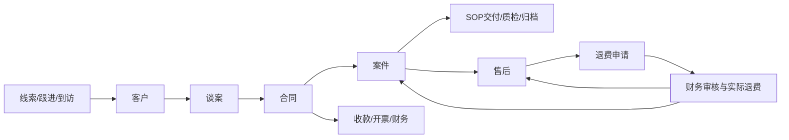

# 承业OA当前实现Spec总纲

本次对齐以 **2026-11-06、Git `dcf8447d`** 的已开发成果为基线。用户已确认OA功能人工测试完成；本轮将需求总纲、13个业务模块、7项基础契约及开发参考清单与源码对齐，**不修改业务代码、权限配置或数据库记录**。

旧文档与现有实现冲突时，以本次核对到的实际行为为准；尚未实现、仅有历史规划或需外部环境验证的能力明确保留边界。不是把历史所有目标一律标记完成。

## 1. 阅读入口与文档效力

2026-11-07增量：智慧办案改为账号私有的服务器工作区，管理员统一模型配置及连通性测试、会话管理和法律插件的现行约定见[服务器工作区规格](reference/SMART-CASE-SERVER.md)，验证边界见[专项验证记录](VALIDATION-2026-11-07-smart-case.md)。该专项替代历史本机工作区及个人模型设置说明，其余模块继续采用下列基线。

1. 本总纲及下列当前MOD/FTN定义现行功能范围和跨模块约束。
2. [变更与冲突处理清单](CHANGES-2026-11-06.md)说明旧文档的替代口径；[追溯矩阵](TRACE.md)连接实现与回归证据。
3. [页面导航](reference/NAVIGATION.md)、[API清单](reference/HTTP-API.md)、[权限目录](reference/PERMISSIONS.md)、[标准字段](reference/STANDARD-FIELDS.md)、[数据模型](reference/DATA-MODELS.md)由源码生成，提供逐项技术细节。
4. [验收与维护](ACCEPTANCE.md)区分用户人工验收、本轮文档校验和以后代码回归；[文档约定](CONVENTIONS.md)规定维护方法。
5. [对齐前历史快照](history/2026-11-06-before-alignment/README.md)、既有专项设计、superpowers/specs/plans/reports及旧PRD保留设计演进证据，冲突内容不能覆盖本基线。历史需求编号不删除、不复用。

## 2. 当前产品结构

承业OA是律所组织协作与业务办理系统，使用同一套组织账号和权限框架，把正式客户/合同/案件等领域记录映射到多维工作表，并允许自建表和标准行政人事模板。

| 一级区 | 主要功能 | 核心边界 |
|---|---|---|
| 工作台 | 待办、统一可视化审批、通知、协同日历、我的权限/安全设置 | 审批与提醒不隐式授予业务读写权 |
| 云盘 | 工作区、文件夹、Base、数据表、分享、归档/回收、快捷入口 | 私人资源与共享资源保留所有权和授权边界 |
| 业务应用 | 客户经营、签约交付、SOP/质量、财务、综合行政管理 | 正式业务表读写使用原领域服务 |
| 数据分析 | 经营概览、绩效/工资、质量、异常、领用统计、可视化仪表盘 | 每次按访问者权限查询，不共享全库缓存 |
| 管理中心 | 组织岗位员工团队、账号角色、授权、治理、事件、安全及相关配置 | 信任根保护、任期和敏感操作校验 |

知识库与智慧办案是全局授权入口。前端路由及菜单的94项注册（含隐藏详情页）见导航附录，不能把“有路由”解释为“所有用户可见”。

## 3. 主要业务链路

这些是已有对象的业务关联，不表示任意前一步保存都自动生成所有后续对象。创建、完结、审批、实际执行各自调用受控动作。业务工作表共享正式ID；普通自建表不会因为命名为“合同管理表”就自动变成合同业务表。

## 4. 统一交互和权限

- 双击可编辑单元格修改并保存/取消，行末按capabilities提供编辑、详情/办理、删除；受控状态和同步字段不能任意改。
- 表格刷新合并并避让编辑，消息提醒不重置草稿。提交失败保留输入，流程校验提供板块定位。
- 菜单、动作、业务数据范围、工作区/表资源、行范围、字段及状态规则共同生效；角色名称不等于固定全部权限。
- 共享表/仪表盘配置不扩大业务范围；普通账号与超管在相同授权数据交集内显示同一记录，不要求两者看到全库相同内容。
- 已通过审批更正需新申请重新审批，原单和历史保留；SOP及专项关闭保留禁止自审、材料校验和业务回写。
- 外观偏好按账号保存；人事月份日期不补日；未确定公式字段只读保留。

## 5. 模块规格

| 规格 | 内容 |
|---|---|
| [MOD-001 组织、账号、岗位与权限](modules/MOD-001-organization-permission.md) | 已实现范围、约束、验收要求及代码/回归入口 |
| [MOD-002 多维表格、云盘与配置](modules/MOD-002-system-config-center.md) | 已实现范围、约束、验收要求及代码/回归入口 |
| [MOD-003 渠道与获客入口](modules/MOD-003-brand-acquisition.md) | 已实现范围、约束、验收要求及代码/回归入口 |
| [MOD-004 线索、跟进、公海与到访](modules/MOD-004-lead-crm.md) | 已实现范围、约束、验收要求及代码/回归入口 |
| [MOD-005 客户主数据](modules/MOD-005-customer-master-data.md) | 已实现范围、约束、验收要求及代码/回归入口 |
| [MOD-006 谈案、合同与财务](modules/MOD-006-contract-finance.md) | 已实现范围、约束、验收要求及代码/回归入口 |
| [MOD-007 专业团队SOP及成果审核](modules/MOD-007-professional-team-sop.md) | 已实现范围、约束、验收要求及代码/回归入口 |
| [MOD-008 案件、售后、退费、归档与质检](modules/MOD-008-case-delivery-qc.md) | 已实现范围、约束、验收要求及代码/回归入口 |
| [MOD-009 满意度、复购与转介绍边界](modules/MOD-009-satisfaction-repurchase-referral.md) | 已实现范围、约束、验收要求及代码/回归入口 |
| [MOD-010 文件、知识库与智慧办案](modules/MOD-010-ai-recording-file.md) | 已实现范围、约束、验收要求及代码/回归入口 |
| [MOD-011 综合行政、人力资源与库存](modules/MOD-011-organization-hr.md) | 已实现范围、约束、验收要求及代码/回归入口 |
| [MOD-012 经营分析、可视化仪表盘与领用统计](modules/MOD-012-management-dashboard.md) | 已实现范围、约束、验收要求及代码/回归入口 |
| [MOD-013 可视化审批、通知、日历与审计](modules/MOD-013-automation-notification-approval-audit.md) | 已实现范围、约束、验收要求及代码/回归入口 |

## 6. 基础契约

| 规格 | 内容 |
|---|---|
| [FTN-001 数据模型与业务真源](foundations/FTN-001-data-model.md) | 已实现范围、约束、验收要求及代码/回归入口 |
| [FTN-002 状态、字典与只读投影](foundations/FTN-002-state-machine-dictionary.md) | 已实现范围、约束、验收要求及代码/回归入口 |
| [FTN-003 权限、数据范围与共享交集](foundations/FTN-003-rbac-data-scope.md) | 已实现范围、约束、验收要求及代码/回归入口 |
| [FTN-004 接口、事务、版本与错误](foundations/FTN-004-api-transaction-consistency.md) | 已实现范围、约束、验收要求及代码/回归入口 |
| [FTN-005 事件、协作更新与后台任务](foundations/FTN-005-event-driven-model.md) | 已实现范围、约束、验收要求及代码/回归入口 |
| [FTN-006 可视化审批执行契约](foundations/FTN-006-approval-task-notification.md) | 已实现范围、约束、验收要求及代码/回归入口 |
| [FTN-007 运行、安全、交互与验证边界](foundations/FTN-007-non-functional-requirements.md) | 已实现范围、约束、验收要求及代码/回归入口 |

## 7. 基线规模及未作出的承诺

源码清单：48组标准字段模板、730个字段定义、125个Prisma模型、89个迁移目录、408个HTTP接口注册、199项权限。上述数字是源码静态规模，不是线上记录数量、数据库迁移已应用数量或全量通过的测试数量。

当前只开放GRID原生表视图；仪表盘18种展示组件另有范围。未确定的律师提成等公式、售后“是否解除合同”规则仍保留只读占位。外部飞书/钉钉、完整品牌营销/问卷闭环、任意脚本自动化、独立桌面安装与更新、生产灾备或并发SLA不在本轮据此认定完成。

具体依赖以package/lockfile为准；显示版本V1.2.1、package版本和本次Git基线不是同一个版本体系。已有业务环境不运行空库初始化；本次文档核对不执行任何清理数据、迁移或重新授权。
