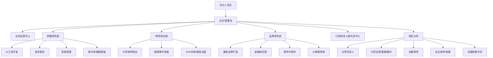

# 承业OA需求Spec总纲

> 权威需求源已迁移至本目录。原 `律所闭环管理系统需求开发文档.md` 保留全文于仓库根，本 README 仅保留全局视图与导航。规范见 [CONVENTIONS.md](CONVENTIONS.md)。

## 1. 产品定位

承业综合管理 OA 系统是一套服务律所“大中台 + 小前台”组织模式的经营闭环系统，不是单一 CRM、单一案件系统或单一行政 OA。

系统需要把律所行政、财务、人事、品牌运营、网络流量管理、客服邀约、谈案签约、律师办案交付、质量控制、客户复购转介绍全部串联起来，形成从“获客”到“签约”再到“办案交付”和“复购转介绍”的完整闭环。

核心闭环如下：

### 1.1 智能化桌面方案（实施中）

2026-09-13 确认 [SPEC-AI-DESKTOP-20260913](../superpowers/specs/2026-09-13-unified-desktop-local-harness.md)，目标 V1.3.0。统一桌面客户端连接云端 OA 业务服务，并运行本地原生 Harness；OA 业务云端校验后生效，本地仅保留缓存与草稿；个人办案目录和会话不自动同步；Wiki 在云端由管理员维护，律师及助手只读调用。Wiki OCR 由管理员在云端使用，个人办案识别通过在线视觉模型 API。选定成果经用户确认后可提交至有权限的 OA 案件档案。具体边界、替代关系与待执行验收见该规格，历史版本验收不代表本方案已实现。

## 2. 组织模型

系统支持“总所大中台 + 分所小前台”的组织模型。

## 3. 关键角色

| 角色 | 核心职责 |
|---|---|
| 系统超级管理员 | 拥有系统管理员全部权限，并负责审核系统管理员的高风险配置变更、数据干预、权限调整和逻辑表格/字段配置变更 |
| 系统管理员 | 管理逻辑表格、资料、动态字段、模板、字典、状态机、SOP 节点、自动化规则和系统配置；可通过受控接口对系统各环节进行必要干预 |
| 合伙人/管委会 | 查看经营驾驶舱、重大事项审批、质量抽检、低满意度专项分析 |
| 主任/管理层 | 管理总所与分所经营目标、团队绩效、资源调配 |
| 前瞻研究部 | 系统管理、AI 工具、技术服务、知识库、数据看板 |
| 律师培训部 | 分所律师培训、疑难案件处理、SOP 训练、专家指导 |
| 品牌宣传部 | 品牌宣传、内容引流、律师 IP、满意度调查、口碑案例库 |
| 分所负责人 | 管理本分所线索、客户、合同、案件、人员和经营数据 |
| 运营/投放人员 | 管理渠道、内容、投放计划、线索归因和 ROI |
| 客服 | 线索初筛、首响、咨询记录、客户标签 |
| 邀约人员 | 邀约计划、到访确认、爽约处理、二次邀约 |
| 谈案律师 | 谈案记录、报价、首签、目标对齐、正式委托 |
| 专业团队负责人 | 管理专业 SOP、分析报告、专家指导、质量审核 |
| 承办律师/助理 | 案件建档、节点任务、文书、沟通、结案复盘 |
| 财务 | 应收、实收、开票、退款、减免、成本统计 |
| 人事 | 员工、岗位、考勤、请假、培训、绩效确认 |

## 4. 主链路闭环

承业 OA 围绕“获客 → 签约 → 办案交付 → 复购转介绍”主链路闭环展开，闭环图见 [§1 产品定位](#1-产品定位) 中的核心闭环 mermaid。

## 5. 范围边界

### 5.1 纳入范围

本 PRD 覆盖以下能力：

| 领域 | 覆盖内容 |
|---|---|
| 组织权限 | 总所、分所、部门、专业团队、岗位、员工、账号、角色、权限、数据范围 |
| 系统配置 | 逻辑表格、动态字段、视图、模板、字典、状态机、SOP、自动化规则、版本发布和回滚 |
| 品牌运营 | 渠道、内容、律师 IP、投放计划、线索归因、品牌素材 |
| 线索销转 | 线索、公海/私海、分配、跟进、邀约、到访、谈案、未成交复盘 |
| 客户主数据 | 客户、联系人、转介绍关系、去重合并、客户标签 |
| 合同财务 | 首签/证据收集合同、正式委托合同、合同模板、编号规则、审批流、电子签入口、应收、收款、开票、退款、成本 |
| 专业团队 | 医疗纠纷、执行、刑事辩护三大团队 SOP，其他团队分类预留 |
| 案件交付 | 轻量案件建档、节点任务、材料、沟通、专家指导、文书审核、结案 |
| 质量知识 | 质量审核、满意度、低满意度专项分析、复盘、知识资产、品牌案例 |
| AI 协同 | 胸牌录音登记、人工上传、实时转写、AI 要点提取、人工修订、供应商适配 |
| 组织人事 | 员工档案、岗位、考勤、请假、培训、绩效、价值观记录、设备领用 |
| 驾驶舱 | 日、周、月经营指标、团队指标、财务指标、交付指标、品牌指标 |
| 自动化 | 线索提醒、材料提醒、报告提醒、回款提醒、客户告知、低满意度触发、通知、审计 |
| 数据流转 | 业务事件、事件订阅、事件投递、同步回调、审批实例、任务处理、消息卡片式操作 |

### 5.2 暂不纳入范围

以下内容不纳入本 PRD 的开发范围，但保留数据和接口扩展位：

1. 分所独立核算、分账、提成自动结算。
2. 复杂薪酬、福利、社保、公积金、招聘 ATS。
3. 客户门户完整功能。
4. 电子签平台深度集成，仅预留签署入口、签署流水号、签署状态和回调字段。
5. 电话系统、企业微信、广告平台的深度集成，仅预留外部来源和接口。
6. 完整案件管理系统中的一案多程序、期限、快递、保全、归档等深度案管能力。
7. 哈希链审计、SSO、SCIM、WebAuthn、SIEM/SOAR 等高级企业安全能力。
8. 本地大模型部署。

## 6. 模块导航

### 6.1 业务模块（MOD-001 ~ MOD-013）

| 编号 | 模块 | 用途 | Spec |
|---|---|---|---|
| MOD-001 | 组织权限 | 总所/分所/部门/专业团队/岗位/员工/账号/角色/权限/数据范围 | [MOD-001 组织权限](modules/MOD-001-organization-permission.md) |
| MOD-002 | 系统配置中心 | 逻辑表格、动态字段、模板、字典、状态机、SOP、自动化规则的版本化治理 | [MOD-002 系统配置中心](modules/MOD-002-system-config-center.md) |
| MOD-003 | 品牌运营与获客 | 渠道、内容、律师 IP、投放计划、线索归因、品牌素材 | [MOD-003 品牌运营与获客](modules/MOD-003-brand-acquisition.md) |
| MOD-004 | 线索销转 | 线索公海/私海、分配跟进、邀约到访、谈案、未成交复盘 | [MOD-004 线索销转](modules/MOD-004-lead-crm.md) |
| MOD-005 | 客户主数据 | 客户唯一主档、联系人、转介绍关系、去重合并、客户标签 | [MOD-005 客户主数据](modules/MOD-005-customer-master-data.md) |
| MOD-006 | 合同财务 | 首签/证据收集合同与正式委托合同的审批、签署、收款、开票、退款、成本 | [MOD-006 合同财务](modules/MOD-006-contract-finance.md) |
| MOD-007 | 专业团队与分析报告 | 医疗纠纷/执行/刑事辩护三大团队 SOP 与分析报告 | [MOD-007 专业团队与分析报告](modules/MOD-007-professional-team-sop.md) |
| MOD-008 | 案件交付与质量控制 | 轻量案件建档、节点任务、材料、专家指导、文书审核、结案复盘、质量审核 | [MOD-008 案件交付与质量控制](modules/MOD-008-case-delivery-qc.md) |
| MOD-009 | 满意度、复购与转介绍 | 满意度调查、低满意度专项分析、复盘、复购与转介绍 | [MOD-009 满意度、复购与转介绍](modules/MOD-009-satisfaction-repurchase-referral.md) |
| MOD-010 | AI、录音与文件 | 胸牌录音登记、人工上传、实时转写、AI 要点提取、人工修订、供应商适配 | [MOD-010 AI、录音与文件](modules/MOD-010-ai-recording-file.md) |
| MOD-011 | 组织人事 | 员工档案、岗位、考勤、请假、培训、绩效、价值观记录、设备领用 | [MOD-011 组织人事](modules/MOD-011-organization-hr.md) |
| MOD-012 | 管理驾驶舱 | 日/周/月经营、团队、财务、交付、品牌指标 | [MOD-012 管理驾驶舱](modules/MOD-012-management-dashboard.md) |
| MOD-013 | 自动化、通知、审批与审计 | 线索/材料/报告/回款提醒、低满意度触发、通知、审批与审计 | [MOD-013 自动化、通知、审批与审计](modules/MOD-013-automation-notification-approval-audit.md) |

### 6.2 横切契约（FTN-001 ~ FTN-007）

所有业务模块共用的横向契约，统一在 `foundations/` 下维护。

| 编号 | 契约 | 用途 | Spec |
|---|---|---|---|
| FTN-001 | 数据模型 | 核心数据对象与表结构契约 | [FTN-001 数据模型](foundations/FTN-001-data-model.md) |
| FTN-002 | 状态机与业务字典 | 状态编码与业务字典契约 | [FTN-002 状态机与业务字典](foundations/FTN-002-state-machine-dictionary.md) |
| FTN-003 | RBAC 与数据范围 | 角色、权限、数据范围的横向授权契约 | [FTN-003 RBAC 与数据范围](foundations/FTN-003-rbac-data-scope.md) |
| FTN-004 | API、事务与一致性 | API 规范、错误码、事务边界与一致性契约 | [FTN-004 API、事务与一致性](foundations/FTN-004-api-transaction-consistency.md) |
| FTN-005 | 事件驱动模型 | 业务事件、事件订阅投递、同步回调的协同契约 | [FTN-005 事件驱动模型](foundations/FTN-005-event-driven-model.md) |
| FTN-006 | 审批、任务与消息通知 | 审批实例、任务处理、消息卡片式操作契约 | [FTN-006 审批、任务与消息通知](foundations/FTN-006-approval-task-notification.md) |
| FTN-007 | 非功能需求 | 性能、安全、合规等非功能横向要求 | [FTN-007 非功能需求](foundations/FTN-007-non-functional-requirements.md) |

模块级粗粒度追溯（专项设计 / 已落地 SPEC / 现状）见 [TRACE.md](TRACE.md)。

## 7. 与下游文档关系

本目录是项目四层文档体系的**需求层**，只回答 *what*——每个业务模块和横切契约要做什么。其与下游三层的关系如下（详见 [CONVENTIONS.md §1](CONVENTIONS.md#1-定位与目标)）：

| 层 | 目录 | 职责 | 与本目录的关系 |
|---|---|---|---|
| 需求 | `docs/spec/` | what — 模块/契约要做什么 | 本目录；新 SPEC 的需求输入源 |
| 设计契约 | `docs/专项设计/` | how — 技术契约（表结构/接口/状态机编码/事件名） | spec 用 `design_refs` 指向；不重写技术契约 |
| 工程规格 | `docs/superpowers/specs/` | SPEC-0xx 工程执行规格（设计+实施规格） | 一个 MOD 可由多个 SPEC 分批落地，新 SPEC 在「需求来源」引用 `docs/spec/MOD-NNN` + `FTN-NNN` |
| 实施 | `docs/superpowers/plans/` + 源码 | 实施计划与代码落地、验收 | spec 层只追溯不动已验收的 SPEC 闭环 |

边界纪律（见 [CONVENTIONS.md §6 演进纪律](CONVENTIONS.md#6-演进纪律)）：已完成的工作是事实源，spec 层只追溯不回填 SPEC、不重测；新 SPEC 以 spec 文档为需求输入向前驱动；规范变化只改 CONVENTIONS。

2026-09-13 阶段一更新：统一桌面基础、原生本机目录读写及历史会话恢复已验证；完整 V1.3.0 待后续能力和发布验收。参见 [实施记录](../superpowers/plans/2026-09-13-unified-desktop-local-harness.md)。
