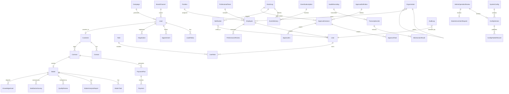

# FTN-001 数据模型

## 1. 契约概述

源 PRD §9.1 核心对象关系。本契约定义承业 OA 系统需求侧的核心数据对象及其关系，作为所有业务模块「数据对象」段的统一引用源。

## 2. 契约定义

源 PRD §9.2 建议核心表。

> 注：物理 schema 以 Prisma `apps/server/prisma/schema.prisma` 49 model 为准，本契约为需求侧对象关系定义。

| 表 | 用途 |
|---|---|
| Organization | 总所、分所、部门、团队、小组 |
| ProfessionalTeam | 医疗纠纷、执行、刑事辩护和其他专业团队分类 |
| Position | 岗位 |
| Employee | 员工主档 |
| User / Role / Permission / DataScope | 账号、角色、权限和数据范围 |
| SystemConfig | 系统配置项 |
| DynamicFieldConfig | 表格和字段配置 |
| TemplateConfig | 节点模板、材料模板、文书模板、审核说明模板 |
| ConfigVersion | 配置版本、差异内容、生效范围和回滚关系 |
| ConfigPublishRecord | 配置发布、停用、归档和回滚记录 |
| AdminOperationReview | 系统管理员操作审核，区分事前审核和事后复核 |
| DataInterventionRequest | 业务数据干预申请、前后快照、原因和回滚信息 |
| Campaign | 投放、直播、活动、内容计划 |
| BrandContent | 品牌内容和律师 IP 内容 |
| Lead / LeadFollow / LeadPool | 线索、跟进、公海/私海 |
| Appointment | 邀约和到访 |
| Negotiation | 谈案、报价、未签原因 |
| Customer / Contact / ReferralRelation | 客户、联系人、转介绍 |
| Contract / ContractTemplate / ContractNumberRule | 合同、模板、编号规则 |
| PaymentPlan / Payment / InvoiceRequest / RefundRequest | 应收、实收、开票、退款 |
| CostEntry | 渠道成本、证据收集成本、个案成本 |
| AnalysisEngagement | 首签后证据收集、案件分析、目标对齐 |
| MatterAnalysisReport | 病历分析、执行分析、刑事初判、深度分析报告 |
| Matter / MatterTask / MatterNode | 案件、任务、节点 |
| MatterNodeRequirement | 节点资料上传要求、模板、提示说明和启用状态 |
| AudioRecording | 胸牌录音登记、文件、设备、场景 |
| TranscriptionJob | 实时/异步转写任务 |
| AiExtractionResult | AI 提取结果和人工修订 |
| AiProviderConfig | 模型供应商配置元数据，不保存 apiKey |
| QualityReview | 一级/二级质量审核 |
| SatisfactionSurvey | 客户满意度调查 |
| SpecialAnalysis | 低满意度专项分析 |
| KnowledgeAsset | SOP、文书、专家意见、复盘、品牌素材 |
| AttendanceRecord / LeaveRequest | 考勤、请假 |
| TrainingPlan / TrainingRecord | 培训计划和记录 |
| PerformanceReview / PerformanceConfirmation | 绩效和人工确认 |
| ValueAssessment | 价值观践行记录 |
| EquipmentAssignment | 设备领用 |
| AutomationRule | 自动提醒/回收/预警规则 |
| EventLog | 业务事件原始记录 |
| EventSubscription | 事件订阅关系 |
| EventDelivery | 事件投递、重试和消费结果 |
| EventHandlerLog | 事件处理器执行日志 |
| CallbackAction | 同步回调操作，例如消息卡片按钮、AI 结果确认、审批操作 |
| ApprovalDefinition | 审批定义、表单字段、节点规则 |
| ApprovalInstance | 审批实例 |
| ApprovalTask | 审批任务 |
| ApprovalCc | 审批抄送 |
| Notification | 通知、消息、待办、已办 |
| AuditLog | 审计日志 |

### 多维协作对象扩展（2026-09-14，待实现）

本节新增需求对象不包含在历史 SPEC-001/003 验收中，工程定义见 [SPEC-COLLAB-20260914](../../superpowers/specs/2026-09-14-feishu-aligned-collaborative-workspace.md) §3/8。工作区与应用拥有独立资源归属；表定义、字段定义、视图定义分别描述表、类型和展示配置。个人偏好属于账号，视图不拥有业务记录副本。

目标新增对象：Workspace、Base、WorkspaceMembership、TableDefinition、FieldDefinition、ViewDefinition、UserViewPreference、Record、BusinessRecordExtension、RecordRelation、RecordRevision、RecordComment。核心业务对象通过适配器引用现有 ID，通用自建表拥有实际记录；字段名称变化不改变标识与关联。

数据不变量：记录必须属于对应表/组织，字段值必须符合生效字段类型，关联必须校验目标归属和权限。总表与个人视图操作同一记录；复制结构不复制数据和授权。表/字段归档保留历史；配置恢复不能恢复已撤销权限。新增元数据、关系、评论、历史和附件引用纳入一致备份恢复。

验收：空白建表无需新增物理模型或应用发版；字段改名后视图和关系不失效；核心表不出现可独立修改的第二份真值；两种数据源都支持同源多视图。

## 3. 规则与边界

数据模型设计原则（源 `docs/专项设计/数据库核心表设计草案.md` §1）：

1. 采用模块化单体、单 PostgreSQL 实例，不按分所拆库。
2. 业务表使用 UUID 主键，另设可读业务编号；外键引用 ID，不以名称关联。
3. 通用审计字段：`created_at`、`created_by`、`updated_at`、`updated_by`、`deleted_at`、`version`。
4. 金额使用 `numeric(18,2)`，时间使用 `timestamptz`，结构化扩展数据使用 `jsonb`。
5. 核心状态使用稳定英文编码，中文名称由业务字典维护。
6. 核心数据软删除；AuditLog、EventLog、审批记录、收款记录不得业务删除。
7. 多分所隔离依赖 `organization_id`、`branch_id`、`team_id` 与 DataScope，不使用数据库租户隔离。

## 4. 被引用模块

以下所有业务模块的「数据对象」段均引用本契约：

- MOD-001 组织权限模块
- MOD-002 系统配置中心
- MOD-003 品牌运营与获客
- MOD-004 线索销转
- MOD-005 客户主数据
- MOD-006 合同财务
- MOD-007 专业团队与分析报告
- MOD-008 案件交付与质控
- MOD-009 满意度、复购与转介绍
- MOD-010 AI、录音与文件
- MOD-011 组织人事
- MOD-012 管理驾驶舱
- MOD-013 自动化、通知、审批与审计

## 5. 验收要求

源 PRD §14.1 通用验收要求中与本契约相关的条目：

1. 接口验收：参数校验、权限校验、数据范围、分页、错误码、审计记录。
2. 事务验收：合同生效、收款确认、客户合并、低满意度触发必须验证一致性。
3. 主数据验收：客户、合同、收款、案件、人员必须验证唯一数据源，消费模块不得绕过主模块直接修改。
4. 数据安全验收：L3/L4 字段脱敏、下载、导出、授权、审计和水印规则必须可验证。
5. 回调验收：审批同意、任务完成、AI 结果确认等同步回调必须校验权限、状态和重复提交。
6. 配置验收：动态字段、模板、字典、SOP 和自动化规则必须验证草稿、审核、发布、停用、回滚和历史版本读取。
7. 管理员治理验收：高风险操作审核前不得生效；低风险操作生效后进入复核；管理员不得自审或给本人提权。

PRD §14.2 端到端验收链路中与本契约相关：

- 重复提交合同生效、重复确认收款、重复处理审批任务时，系统应通过幂等机制避免重复生成应收、案件、通知或统计。
- 系统管理员发起合同/收款/案件状态干预后，系统在超级管理员审核通过前不得修改业务数据；通过后保留前后快照和完整审计链路。

## 6. 追溯

云盘增量模型见 [SPEC-DRIVE G1 契约](../../superpowers/specs/2026-09-15-cloud-drive-g1-contract.md)：统一 DriveNode 区分文件夹与 Base 目录节点；Base 节点沿用原 ID/唯一标题源/内容数据，文件夹与组织树分开。旧资源幂等接入，不伪造缺失的历史创建时间，迁移和回退不得丢失内容或解除文件夹授权。G1 已落地为第 53 条增量迁移；模型与迁移基线为 88/53，旧资源接入和重入验证见云盘实施记录。

- 专项设计: docs/专项设计/数据库核心表设计草案.md
- 落地 SPEC: SPEC-001, SPEC-003
- 主要代码: apps/server/prisma/schema.prisma
- 测试: 无

G2-A 生命周期增量见[移动与回收契约](../../superpowers/specs/2026-09-15-cloud-drive-g2-lifecycle.md)：第 54 条迁移为 DriveNode 增加 deletedAt/deletedBy 配对标记，只有显式回收根落标记，子树由祖先状态阻断。活跃同级文件夹名称采用部分唯一索引；Base 沿用全工作区名称唯一。内容不物理删除，恢复仍使用原 ID；当前模型/迁移基线为 88/54。

G2-B [导航元数据](../../superpowers/specs/2026-09-15-cloud-drive-g2b-shortcuts-recents.md)新增 DriveShortcut（同区原节点引用，软移除、位置/目标外键与部分唯一索引）和 DriveVisit（userId/nodeId 唯一、按个人工作区保留 100 项）。第 55 条迁移增量接入，当前模型/迁移基线 90/55；不复制资源名称、ACL 或业务内容。

### 全站统一框架（2026-09-15）

本批仅迁移前端框架和页面归属，不新增模型、迁移或复制业务记录；数据库保持 90 模型/55 迁移。所有旧记录 ID、关联与审计引用不变。实现前契约见[U0/U1 导航与迁移矩阵](../../superpowers/specs/2026-09-15-unified-navigation-contract.md)。

### U4 线索业务工作区

U4 不新增模型或迁移；Lead/LeadFollow 仍是权威事实，目录连接仅存元数据，返回的关联显示标签不替代原 Lead.id。 工程契约见[线索与跟进统一](../../superpowers/specs/2026-09-15-u4-lead-workspace.md)，验收记录见全站统一计划第 7 节。

### U5-A 正式来源扩展

CUSTOMERS / NEGOTIATIONS / CONTRACTS 直接读取 Customer / Negotiation / Contract，复用 CollabExtension，稳定业务 ID 不变；无新模型和迁移，基线仍 90/55。字段元数据带 businessSource 用于准确显示状态；核心金额保留 Decimal 字符串。详见[U5–U7 契约](../../superpowers/specs/2026-09-15-u5-u7-business-unification.md)。

### U5-B 案件身份增量（2026-09-15）

迁移 20260915210000_case_creator_organization 为 Case 增加 nullable createdBy/branchId/updatedBy 和前两列索引；模型总数仍 90，迁移数 56。历史创建人仅恢复无歧义 CASE_CREATE 审计，组织仅使用明确合同或已校验受理部门；保留全部原 ID 与关联，缺失事实留空并通过审计补录。CASES 多维来源与受理列直接回源，无新业务副本。[迁移及验收契约](../../superpowers/specs/2026-09-15-u5-u7-business-unification.md)。
