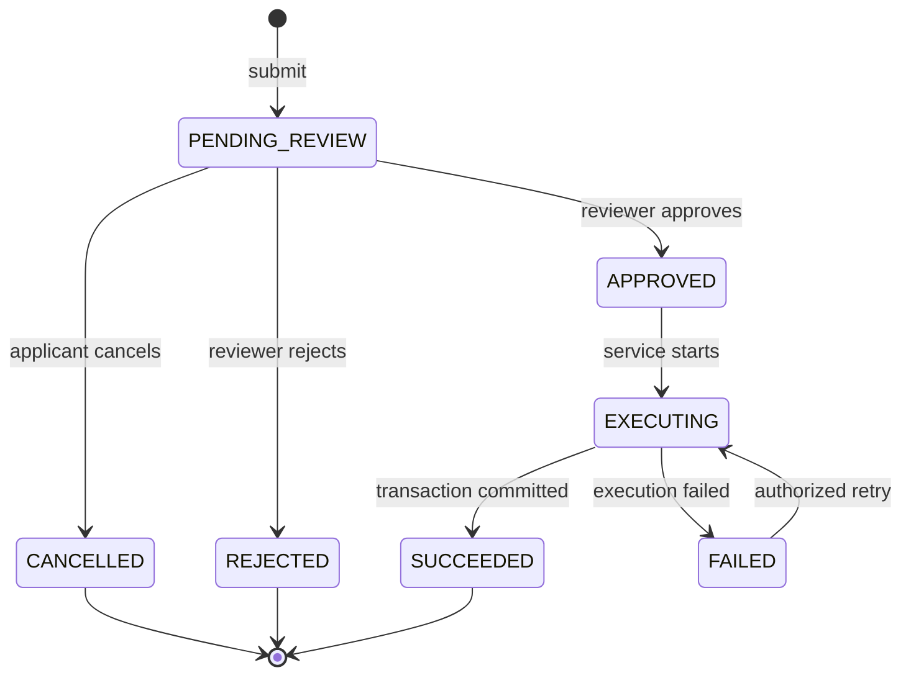
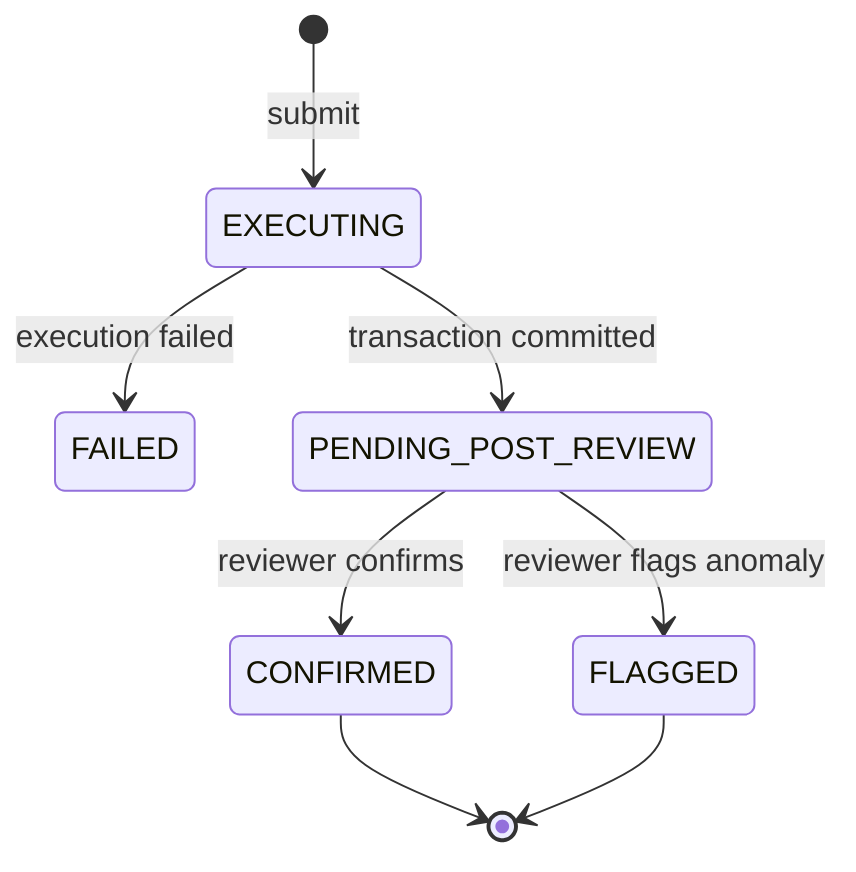

# SPEC-005：系统管理员治理、超级管理员审核与受控数据干预设计

> 状态：已批准，实施 Plan 已生成  
> 日期：2026-07-21  
> 需求基线：`律所闭环管理系统需求开发文档.md` V1.0  
> 前置 Spec：SPEC-001、SPEC-002、SPEC-003、SPEC-004、SEC-SPEC-001 已完成本地实施和验收  
> 关联专项设计：`docs/专项设计/系统管理员与超级管理员权限设计.md`、`docs/专项设计/角色权限与数据范围设计.md`、`docs/专项设计/审计日志与自动化规则设计.md`  
> 实施约束：本文件只定义业务与系统设计；用户确认后再编写实施 Plan，本轮不生成代码，不执行 GitHub 操作

## 1. 背景

SPEC-002 已建立首位 `SYSTEM_SUPER_ADMIN` 信任根和恢复命令，SPEC-004 已建立 RBAC、数据范围、敏感字段权限和权限追踪能力，并预留 `SYSTEM_ADMIN` 角色编码。当前系统仍缺少企业级管理员治理闭环：

1. `SYSTEM_ADMIN` 尚未正式创建、授权和回收。
2. 超级管理员管理系统管理员或其他超级管理员时，缺少职责分离和禁止自审机制。
3. 高风险操作尚不能在生效前审核，低风险操作也没有事后复核状态。
4. 管理员尚无受控的数据修正入口，容易诱发直接数据库修改。
5. 现有 `Approval` 是早期通用审批原型，字段和状态不足以表达不可变参数快照、风险级别、执行尝试、幂等、并发校验和事后复核。
6. 现有 `OperationLog` 已被系统初始化、鉴权、主数据和敏感访问使用，适合作为系统审计索引，但不能单独承担治理聚合与审核状态。

系统管理员是“最高执行角色”，超级管理员是“最高治理角色”。两者都不能绕过领域规则、审计或直接修改数据库。

## 2. 目标

1. 正式引入固定系统角色 `SYSTEM_ADMIN`，建立授予、撤销、停用和有效期治理闭环。
2. 对系统管理员和超级管理员账号操作实施双人职责分离，禁止申请人审核本人操作。
3. 建立统一的管理员治理内核，支持 HIGH/CRITICAL 事前审核和 LOW 事后复核。
4. 使用代码所有的操作目录和领域适配器执行治理操作，拒绝任意表、任意字段和任意 SQL。
5. 首批接入管理员授权变更及有限白名单内的主数据修正，形成真实可验收闭环。
6. 对申请、审核、执行、失败、重试和异常标记保留不可抵赖的结构化记录和系统审计索引。
7. 使用幂等键、参数哈希、乐观锁和数据库事务抵御重复提交、参数篡改、并发审核和部分写入。
8. 为后续配置中心、案件干预、财务修正和通用审批提供稳定适配器契约，但不提前实现这些业务模块。

## 3. 非目标

本 Spec 不实现：

1. 通用审批定义、多节点会签、转交、加签、抄送和消息回调引擎。
2. 动态表格、动态字段、模板、字典、状态机、SOP 和自动化配置中心。
3. 任意 SQL、任意表名、任意字段名、数据库控制台或直接物理结构变更。
4. 飞书、短信、邮件或站内消息通知；待通用消息能力立项后接入治理事件。
5. 任意业务数据的自动回滚。异常操作进入待处置状态，由明确的补偿命令处理。
6. L3/L4 批量导出、录音下载、案件文书下载等业务审核流程。
7. MFA、SSO、SCIM、设备信任和异常登录预警。
8. 复用或改造现有 `Approval` 原型；其后续去留由通用审批 Spec 决定。

## 4. 方案决策

### 4.1 采用：治理内核 + 领域适配器

```text
Governance HTTP/CLI Entry
  -> AuthorizationContext
  -> GovernedOperationCatalog
  -> AdminGovernanceService
  -> Review and State Machine
  -> GovernedOperationAdapter
  -> Existing Domain Service
  -> Business Mutation + Execution Record + OperationLog in one transaction
```

治理内核只负责稳定的共性规则：权限、风险、审核模式、状态流转、禁止自审、不可变快照、幂等、并发控制、执行记录和审计。领域适配器负责目标存在性、业务不变量、执行前后快照及实际变更。

### 4.2 不采用的方案

| 方案 | 不采用原因 |
| --- | --- |
| 直接扩建通用审批引擎 | 会提前引入流程定义、任务分派、消息回调和会签等独立系统，扩大 SPEC-005 范围 |
| 在每个 Controller 内写审核判断 | 规则分散，容易出现某条路径漏审、自审或重复执行 |
| 使用任意数据修正脚本 | 无法限定影响范围，难以提供业务级校验、前后快照和可测试的补偿行为 |
| 让 `SYSTEM_ADMIN` 隐式拥有全部权限 | 新增权限会被自动继承，可能意外获得审核、信任根或未来高危能力 |

## 5. 角色与职责边界

### 5.1 系统管理员

`SYSTEM_ADMIN` 是固定 `SYSTEM` 角色，负责被授权范围内的系统维护和受控业务干预：

1. 可查看本人治理申请、提交允许的主数据干预并撤销待审核申请。
2. 不可审核任何治理申请。
3. 不可创建、授予、撤销或停用系统管理员和超级管理员。
4. 不可修改 `SYSTEM_ADMIN` 或 `SYSTEM_SUPER_ADMIN` 角色本身及其权限。
5. 不可关闭、删除或修改治理记录和审计日志。
6. 不受普通组织数据范围限制执行治理命令，但目标、原因和结果必须完整审计。
7. 敏感字段原文读取、下载和导出仍受 SPEC-004 的字段权限及用途审计约束。

### 5.2 系统超级管理员

`SYSTEM_SUPER_ADMIN` 延续 SPEC-002 和 SPEC-004 的信任根语义：

1. 可发起系统管理员或超级管理员账号治理申请。
2. 可审核其他管理员发起、且本人具备审核资格的申请。
3. 可查看全部治理申请、审核记录和执行结果。
4. 不可审核本人申请，不可关闭审计，不可直接修改数据库。
5. 涉及本人账号、角色或授权的操作必须由另一名有效超级管理员发起和审核，申请人、目标用户和审核人的组合必须满足对应命令约束。
6. 系统始终至少保留一名有效超级管理员。

### 5.3 普通业务角色

普通业务角色无权访问治理目录、治理申请、审核、执行详情和恢复命令。前端隐藏入口不构成授权依据，服务端必须默认拒绝。

## 6. 系统角色供应规则

1. 数据库迁移或系统目录同步创建唯一 `SYSTEM_ADMIN` 角色，状态为 `ENABLED`，默认不授予任何用户。
2. `SYSTEM_ADMIN` 角色不能通过普通角色创建、修改、停用、删除或权限替换接口操作。
3. 系统管理员权限采用代码内置的明确允许清单；新增权限默认不进入该清单。
4. 允许清单不得包含治理审核、超级管理员治理、信任根恢复、审计修改或其他明确禁止能力。
5. 目录同步允许追加经代码审查批准的权限，但不得静默移除现有授权；移除须由独立迁移明确处理并保留审计。
6. 用户获得系统角色后，仍必须满足账号启用、角色启用、有效期和撤销状态校验。
7. 系统角色授权复用 `UserRole` 的 `validFrom`、`validUntil`、授予原因、授予人、撤销时间和版本字段。

## 7. 操作目录与风险

操作目录由代码维护，服务启动时验证操作类型唯一、风险等级合法、审核模式明确、适配器存在且输入模式可校验。数据库和前端不能自行创建新操作类型。

### 7.1 首批操作

| 操作类型 | 允许发起人 | 风险 | 审核 | 目标与结果 |
| --- | --- | --- | --- | --- |
| `SYSTEM_ADMIN_GRANT` | 超级管理员 | HIGH | 事前 | 为有效用户授予 `SYSTEM_ADMIN`，支持有效期 |
| `SYSTEM_ADMIN_REVOKE` | 超级管理员 | HIGH | 事前 | 撤销目标用户当前有效的系统管理员授权 |
| `SYSTEM_ADMIN_ACCOUNT_DISABLE` | 超级管理员 | HIGH | 事前 | 停用系统管理员账号并使活动凭据失效 |
| `SUPER_ADMIN_GRANT` | 超级管理员 | CRITICAL | 事前 + 二次确认 | 为有效用户授予 `SYSTEM_SUPER_ADMIN` |
| `SUPER_ADMIN_REVOKE` | 超级管理员 | CRITICAL | 事前 + 二次确认 | 撤销目标用户超级管理员授权，且不得移除最后一名 |
| `SUPER_ADMIN_ACCOUNT_DISABLE` | 超级管理员 | CRITICAL | 事前 + 二次确认 | 停用目标超级管理员，且不得停用最后一名 |
| `MASTER_DATA_STATUS_CORRECTION` | 系统管理员或超级管理员 | HIGH | 事前 | 修正组织、岗位或专业团队状态，仍执行领域不变量 |
| `MASTER_DATA_METADATA_CORRECTION` | 系统管理员或超级管理员 | LOW | 事后 | 修正固定非敏感展示字段 |

### 7.2 LOW 白名单

首批 LOW 操作只允许以下字段：

| 资源 | 字段 |
| --- | --- |
| Organization | `sort` |
| Position | `responsibilities` |
| ProfessionalTeam | `description` |

姓名、编码、组织父级、物化路径、人员身份、联系方式、证件信息、角色、权限、数据范围、状态和有效期均不属于 LOW 白名单。

### 7.3 主数据状态修正限制

1. 首批支持 Organization、Position 和 ProfessionalTeam；目标状态必须是领域模型允许的状态。
2. 适配器必须调用现有主数据服务，不能直接更新 `status`。
3. 根组织不得停用，存在生效依赖时必须遵循现有拒绝规则。
4. Employee 状态关联入职、转正、离职、任职和汇报关系，不允许使用通用状态修正；后续通过独立人事命令接入。

### 7.4 风险分级

| 风险 | 当前规则 |
| --- | --- |
| LOW | 先执行，成功后进入事后复核 |
| MEDIUM | 本 Spec 不注册实际操作；治理内核按事前审核处理，为后续扩展保留 |
| HIGH | 超级管理员审核通过前不得改变业务数据 |
| CRITICAL | HIGH 的全部要求，加申请人二次确认和更严格的目标保护 |

风险和审核模式不可由请求方传入，以服务端操作目录为准。

## 8. 状态机

### 8.1 事前审核



审核通过与执行可以在同一请求内连续发生，但必须先持久化审核决定，再按事务边界执行。HTTP 超时不代表重复执行，调用方必须通过详情接口查询最终状态。

### 8.2 事后复核



`FLAGGED` 不自动恢复旧值。审核人必须填写异常原因，系统保留前后快照，并为后续补偿申请提供关联标识。

### 8.3 通用状态约束

1. 提交后操作类型、目标对象、参数快照和参数哈希不可修改。
2. 申请人只能撤销 `PENDING_REVIEW` 状态的本人申请。
3. 每次审核决定、执行尝试和状态变化均为追加记录。
4. 已进入终态的记录不能重新打开；需要新申请并通过 `relatedOperationId` 关联。
5. `FAILED` 仅在目录声明 `retryable=true` 且失败未产生业务提交时允许重试；审核已通过但尚无执行尝试的 `APPROVED` 可通过同一入口继续执行，防止进程在审核提交后退出造成永久卡单。
6. 审核、执行和重试均使用版本条件更新；未命中预期版本返回并发冲突。

## 9. 数据模型

### 9.1 AdminOperation

| 字段 | 约束与用途 |
| --- | --- |
| `id` | UUID 主键 |
| `operationNo` | 面向人员的唯一编号 |
| `operationType` | 代码目录中的稳定类型 |
| `riskLevel` | LOW/MEDIUM/HIGH/CRITICAL，由目录复制 |
| `reviewMode` | PRE/POST，由目录复制 |
| `status` | 状态机状态 |
| `requesterUserId` | 申请人 |
| `targetType` / `targetId` | 目标资源类型和标识 |
| `reason` | 必填业务原因，10 至 500 字 |
| `payloadSnapshot` | PostgreSQL JSON，不可变参数快照 |
| `payloadHash` | 规范化 JSON 的 SHA-256 |
| `expectedTargetVersion` | 目标乐观锁版本 |
| `idempotencyKey` | 申请人维度唯一，防止重复提交 |
| `secondConfirmationAt` | CRITICAL 操作申请人二次确认时间 |
| `relatedOperationId` | 补偿、替代或关联申请 |
| `version` | 治理聚合乐观锁版本 |
| `createdAt` / `updatedAt` | 时间戳 |

索引至少覆盖：`operationNo` 唯一、`requesterUserId + createdAt`、`status + createdAt`、`operationType + createdAt`、`targetType + targetId`，以及申请人维度的幂等唯一约束。

### 9.2 AdminOperationReview

| 字段 | 约束与用途 |
| --- | --- |
| `id` | UUID 主键 |
| `operationId` | 所属治理申请 |
| `reviewerUserId` | 审核人，不得等于申请人 |
| `decision` | APPROVE/REJECT/CONFIRM/FLAG |
| `comment` | 拒绝、标记异常时必填；批准和确认可选 |
| `operationVersion` | 做出决定时的聚合版本 |
| `createdAt` | 审核时间 |

审核记录只能追加，不能更新或删除。同一操作、同一有效审核阶段最多接受一个成功决定。

### 9.3 AdminOperationExecution

| 字段 | 约束与用途 |
| --- | --- |
| `id` | UUID 主键 |
| `operationId` | 所属治理申请 |
| `attemptNo` | 从 1 递增，同一操作唯一 |
| `executorType` | SYSTEM 或 CLI；不伪造为审核人 |
| `status` | RUNNING/SUCCEEDED/FAILED |
| `beforeSnapshot` / `afterSnapshot` | 脱敏后的 PostgreSQL JSON |
| `resultCode` | 稳定执行结果码 |
| `errorMessage` | 对人员安全可读的失败摘要，不含密钥和敏感原文 |
| `startedAt` / `finishedAt` | 执行时间 |

### 9.4 OperationLog 兼容

1. 保留现有 `OperationLog` 模型和调用方，避免破坏 SPEC-002 至 SPEC-004 的验收合同。
2. 治理申请、审核决定、执行成功、执行失败、重试和恢复 CLI 均写入 `OperationLog`。
3. `targetType` 使用稳定值 `ADMIN_GOVERNANCE`，`targetId` 使用 `AdminOperation.id`；目标业务对象放入脱敏的新旧值或结构化元数据。
4. `OperationLog` 仍只能通过审计写入服务追加，不提供更新和删除 API。

## 10. 领域适配器契约

每个 `GovernedOperationAdapter` 必须实现：

1. `validatePayload`：使用明确模式拒绝未知字段。
2. `authorizeRequest`：校验发起角色和目标组合。
3. `loadTarget`：在事务内加载目标并取得实际版本。
4. `validateInvariant`：执行最后一名超级管理员保护、目标资格及领域不变量。
5. `snapshotBefore`：生成脱敏、稳定、可比较的执行前快照。
6. `execute`：调用现有领域服务完成一次确定性变更。
7. `snapshotAfter`：生成执行后快照并校验预期结果。
8. `isRetryable`：仅对未提交且重复执行安全的失败返回 true。

适配器不得读取请求方提供的风险、审核模式、表名、字段路径、服务名或 SQL。

## 11. 审核与执行规则

### 11.1 禁止自审

审核服务必须同时检查：

1. 审核人是当前有效的 `SYSTEM_SUPER_ADMIN`。
2. 审核人不是申请人。
3. 审核人账号、角色和授权在审核时仍有效。
4. 操作涉及审核人本人账号或授权时拒绝审核。
5. 目标和治理记录版本仍与提交时一致。

### 11.2 管理员授权

1. 系统管理员授权、撤销或账号停用由一名超级管理员申请、另一名超级管理员审核。
2. 超级管理员授权、撤销或账号停用同样由不同超级管理员申请和审核。
3. 目标用户必须存在且满足对应操作资格；重复授予有效角色不产生第二条并行授权。
4. 撤销使用 `revokedAt`、`revokedByUserId` 和原因，不物理删除 `UserRole`。
5. 停用管理员账号时递增凭据版本或使用现有机制使活动凭据失效。
6. 执行 `SUPER_ADMIN_REVOKE` 或 `SUPER_ADMIN_ACCOUNT_DISABLE` 前，在同一事务内锁定并重新计算有效超级管理员数量。

### 11.3 CRITICAL 二次确认

1. 申请表单展示当前数据库名称、操作类型、目标用户名和影响摘要。
2. 操作目录返回确认短语模板，申请人必须输入由数据库名、操作类型和目标用户名组成的精确短语；服务端根据当前目标重新计算并校验，前端复选框不能替代。
3. 服务端只保存确认时间和校验结果，不保存输入的口令、密码或密钥。
4. 二次确认不是第二名审核人；仍必须由另一名超级管理员审核。

## 12. 单超级管理员恢复窗口

### 12.1 目的

系统初始化后只有首位超级管理员，而正常超级管理员授权需要另一名超级管理员审核。专用恢复 CLI 只用于创建第二名超级管理员，解除首次治理死锁。

### 12.2 准入条件

CLI 必须同时满足：

1. 数据库已完成系统初始化。
2. 当前恰好只有一名有效超级管理员。
3. 操作者输入当前唯一超级管理员用户名，并通过不回显的密码重新验证；无法登录时必须先使用 SPEC-002 凭据恢复流程。
4. 目标用户已存在、账号启用且尚未持有有效超级管理员授权。
5. 操作者输入数据库名、目标用户名、恢复原因和精确确认短语。
6. 命令在本地受控环境执行，不暴露 HTTP 路由。

### 12.3 行为

1. 在单一事务中重新锁定并确认有效超级管理员数量为一。
2. 为目标用户授予 `SYSTEM_SUPER_ADMIN`，记录 `source=RECOVERY` 和原因。
3. 写入 `SUPER_ADMIN_SECOND_SEAT_RECOVERY` 审计日志，操作者记录为已重新验证的唯一超级管理员。
4. 成功后有效超级管理员数量为二，恢复窗口立即关闭。
5. 数量为零、二或更多时全部拒绝；该 CLI 不能授予系统管理员、撤销角色、停用账号或修改权限。

该命令不同于 SPEC-002 的“恢复现有首位超级管理员凭据”命令，名称、确认短语和审计动作必须区分。它是解除首次治理死锁的显式紧急例外，只追加 `OperationLog`，不伪造不存在的申请人、审核人或 `AdminOperationReview`。

## 13. API 契约

所有接口位于 `/api/v1` 路由前缀下；表中省略 `/api` 的现有框架前缀差异，实施 Plan 以当前路由约定为准。

| 方法与路径 | 权限 | 行为 |
| --- | --- | --- |
| `GET /v1/admin-governance/catalog` | `governance.catalog.read` | 返回调用人可申请的操作及表单模式 |
| `POST /v1/admin-governance/operations` | `governance.operation.create` | 提交申请；LOW 在服务端执行后进入事后复核 |
| `GET /v1/admin-governance/operations` | self/all 查询权限 | 分页查询本人、待审核或全部记录 |
| `GET /v1/admin-governance/operations/:id` | self/all 查询权限 | 返回详情、审核和执行时间线 |
| `POST /v1/admin-governance/operations/:id/review` | `governance.review` | 批准、拒绝、确认或标记异常 |
| `POST /v1/admin-governance/operations/:id/cancel` | 申请人 | 撤销本人待审核申请 |
| `POST /v1/admin-governance/operations/:id/retry` | `governance.retry` | 重试可重试失败，或继续尚无执行尝试的 `APPROVED` 操作 |

请求规则：

1. 创建请求必须包含 `operationType`、`targetType`、`targetId`、`reason`、`expectedTargetVersion`、`payload` 和 `idempotencyKey`。
2. 服务端忽略并拒绝客户端传入的风险等级、审核模式、申请人、审核人和状态。
3. CRITICAL 创建请求额外包含确认短语；确认短语不作为身份凭据，不另建挑战表或挑战接口。
4. 列表默认按 `createdAt desc, id desc` 稳定排序，使用分页上限，不能返回敏感快照原文。
5. 详情按调用人权限裁剪；密码 Hash、token、密钥、身份证原文等任何情况下均不得进入快照或响应。
6. 审核接口必须携带调用人看到的 `expectedOperationVersion`。

## 14. 权限目录

SPEC-005 新增稳定权限编码：

| 权限 | 用途 |
| --- | --- |
| `menu.admin_governance` | 管理员治理页面入口 |
| `governance.catalog.read` | 查看本人可用操作目录 |
| `governance.operation.create` | 创建治理申请 |
| `governance.operation.read_self` | 查看本人申请 |
| `governance.operation.read_all` | 查看全部申请与执行详情 |
| `governance.review` | 执行事前审核和事后复核 |
| `governance.retry` | 重试允许重试的失败操作 |
| `governance.audit.read` | 查看治理审计时间线 |

`SYSTEM_ADMIN` 允许清单包含菜单、目录、创建、本人查询及其业务执行权限，不包含 `read_all`、`review`、`retry` 和超级管理员治理能力。`SYSTEM_SUPER_ADMIN` 继续通过统一授权上下文获得全部已注册权限，但仍受禁止自审和目标本人保护等业务硬门约束。

## 15. 管理界面

### 15.1 页面结构

管理员治理中心使用紧凑工作台布局：

1. “我的申请”：当前用户提交的治理记录。
2. “待我审核”：当前超级管理员有资格审核且非本人提交的记录。
3. “全部记录”：仅超级管理员可见。
4. 状态、操作类型、风险、申请人和时间筛选。
5. 详情抽屉展示申请原因、目标摘要、不可变参数、审核记录、执行前后差异和时间线。

### 15.2 交互规则

1. 创建表单由操作目录驱动，只展示明确字段，不提供 JSON 编辑器。
2. 目标使用可搜索选择器，并展示当前版本和状态。
3. HIGH/CRITICAL 提交前展示影响摘要；CRITICAL 使用独立确认对话框。
4. 审核按钮只出现在当前状态和权限允许时，拒绝与标记异常必须填写原因。
5. 仅当服务端返回 `retryable=true` 时展示“重试”；`APPROVED` 且尚无执行尝试时展示“继续执行”。
6. 前端禁用或隐藏不构成安全控制，所有规则由服务端重新判断。
7. 桌面和移动视口不得出现文字遮挡、横向失控或无法触达的操作按钮。

## 16. 一致性、幂等与失败处理

1. 规范化 JSON 后计算 `payloadHash`；审核和执行前重新计算，不一致即拒绝。
2. `requesterUserId + idempotencyKey` 唯一；相同键和相同哈希返回原记录，不同哈希返回冲突。
3. 审核使用 `id + status + version` 条件更新，保证并发审核只有一个决定成功。
4. 执行前重新加载目标并比较 `expectedTargetVersion`；不一致返回 `STALE_TARGET_VERSION`。
5. 业务变更、授权历史、执行成功记录和 `OperationLog` 在同一事务提交。
6. 外层治理状态不得声称成功而业务事务回滚；失败必须保存安全错误摘要。
7. 对无法判断是否已提交的错误默认不可自动重试，需查询目标状态或发起新补偿操作。
8. HTTP 客户端超时后不得生成新幂等键盲目重试。

## 17. 错误码

| 错误码 | HTTP | 含义 |
| --- | --- | --- |
| `GOVERNANCE_OPERATION_NOT_ALLOWED` | 403 | 当前用户不可发起该操作 |
| `GOVERNANCE_SELF_REVIEW_FORBIDDEN` | 403 | 申请人试图审核本人申请 |
| `GOVERNANCE_REVIEW_TARGET_CONFLICT` | 403 | 操作涉及审核人本人账号或授权 |
| `OPERATION_ALREADY_PROCESSED` | 409 | 操作已被审核、撤销或进入终态 |
| `IDEMPOTENCY_KEY_REUSED` | 409 | 同一幂等键对应不同请求参数 |
| `STALE_TARGET_VERSION` | 409 | 目标已被其他操作修改 |
| `PAYLOAD_HASH_MISMATCH` | 409 | 参数快照完整性校验失败 |
| `LAST_SUPER_ADMIN_PROTECTED` | 409 | 操作会移除或停用最后一名超级管理员 |
| `RECOVERY_WINDOW_NOT_AVAILABLE` | 409 | 当前不满足单超级管理员恢复条件 |
| `OPERATION_NOT_RETRYABLE` | 409 | 失败类型或目录不允许重试 |
| `TARGET_NOT_ELIGIBLE` | 422 | 目标存在但不满足操作资格 |
| `RESOURCE_NOT_FOUND_OR_FORBIDDEN` | 404 | 目标不存在或调用人无权枚举 |

错误响应不得包含 SQL、堆栈、密码、Hash、token、连接串或未经脱敏的快照。

## 18. 审计与安全

1. 申请创建、二次确认、审核、拒绝、撤销、执行、失败、重试、确认、标记异常和恢复 CLI 均写审计。
2. 审计记录包含请求标识、操作者、操作类型、目标标识、结果码、IP、User-Agent 和时间；CLI 使用明确来源标识。
3. 审计只保存脱敏参数和差异，不保存密码、确认短语、凭据、密钥或 L4 原文。
4. 治理表和 `OperationLog` 不提供物理删除或更新历史的业务接口。
5. 系统管理员和超级管理员读取或下载治理详情同样写访问审计。
6. 超级管理员不能通过隐式全权限绕过禁止自审、最后一名保护、参数哈希、目标版本或二次确认。
7. 日志写入失败时，高风险业务变更必须失败并回滚。

## 19. 验收标准

### 19.1 管理员授权闭环

1. 两名不同超级管理员可分别完成申请和审核，成功授予系统管理员。
2. 审核前目标用户不具备系统管理员权限，审核并执行成功后立即生效。
3. 撤销后历史 `UserRole` 保留，当前权限立即失效。
4. 同一超级管理员不能审核本人申请，也不能审核涉及本人授权的操作。
5. 重复授予、重复撤销、重复审核和并发审核不会产生重复业务变更。

### 19.2 超级管理员保护

1. CRITICAL 操作缺少精确二次确认时不能提交。
2. 最后一名有效超级管理员不能被撤销或停用。
3. 目标状态在审核前变化时，执行返回版本冲突且不覆盖新状态。
4. 单超级管理员恢复 CLI 只能创建第二名超级管理员；数量不等于一时拒绝。
5. 恢复 CLI 与 SPEC-002 凭据恢复命令具有不同确认短语和审计动作。

### 19.3 数据干预

1. HIGH 主数据状态修正审核前不改变目标。
2. LOW 白名单字段修改成功后进入 `PENDING_POST_REVIEW`。
3. 白名单外字段、未知资源、任意 JSON 路径和未知操作类型全部拒绝。
4. 适配器继续执行根组织保护、依赖检查和其他现有领域规则。
5. `FLAGGED` 不自动回滚，保留异常原因和前后快照。

### 19.4 一致性与审计

1. 相同幂等键与相同请求返回同一治理记录；参数不同返回冲突。
2. 业务事务失败时不留下已成功的授权或主数据变更。
3. 每个治理状态变化均能关联申请人、审核人、执行尝试和 `OperationLog`。
4. 参数被篡改、目标版本过期或执行结果不符合预期时拒绝提交成功状态。
5. 普通业务用户无法访问治理接口或页面。
6. 快照和错误响应不泄露密码 Hash、token、密钥、身份证原文或数据库连接串。

### 19.5 前端验收

1. 系统管理员只看到“我的申请”及允许的操作。
2. 超级管理员能看到待本人审核和全部记录，但本人申请不出现可审核动作。
3. 状态、风险、操作类型和前后差异表达清晰，失败原因可理解。
4. 桌面与移动视口不存在文本重叠、控件溢出或关键按钮不可操作。

## 20. 测试边界

后续实施 Plan 至少安排：

1. 操作目录、状态机、禁止自审、最后一名保护和参数规范化的领域单元测试。
2. 每个领域适配器的合同测试和既有领域不变量回归。
3. PostgreSQL 真实数据库集成测试：事务回滚、行锁、唯一约束、乐观锁和并发审核。
4. API 鉴权、输入校验、错误码、分页和响应脱敏测试。
5. 恢复 CLI 的输入、拒绝路径、事务和审计测试。
6. 前端权限呈现、状态动作、表单白名单和响应式布局测试。
7. SPEC-002 至 SPEC-004 全量回归，证明信任根、鉴权、组织人员和敏感权限未退化。

## 21. 可观测性

首批至少提供：

1. 按操作类型、风险、状态和时间统计治理申请数量。
2. 执行失败、并发冲突、自审拒绝、最后一名保护和恢复 CLI 使用次数。
3. 不记录具体业务参数的结构化应用日志，包含 `requestId`、`operationId` 和 `resultCode`。
4. 对持续 `FAILED`、异常增加的 `FLAGGED` 和恢复 CLI 调用生成可供后续告警系统消费的事件。

本 Spec 不承诺监控平台和消息通知界面，但事件字段必须稳定。

## 22. 需求追踪

| PRD/专项要求 | 本 Spec 落点 |
| --- | --- |
| 系统管理员拥有最高执行权限但不得自提权 | 5.1、6、11.2 |
| 超级管理员审核系统管理员操作 | 5.2、7.1、11.2 |
| 高风险事前审核、低风险事后复核 | 7.4、8 |
| 所有管理员操作形成 AdminOperationReview | 9.2、18 |
| 超级管理员不得自审 | 11.1 |
| 至少保留一名超级管理员 | 11.2、19.2 |
| 单超级管理员启动死锁 | 12 |
| 数据干预只能使用预置命令 | 7、10 |
| 审计不可关闭、修改或删除 | 9.4、18 |
| PostgreSQL 单库和领域服务边界 | 9、10、16 |

## 23. 后续 Spec 接入契约

后续配置中心、案件交付、财务、人事或客户模块接入治理内核时，必须：

1. 在代码操作目录注册稳定操作类型、风险等级、审核模式和权限。
2. 提供明确输入模式和领域适配器，不扩展任意字段入口。
3. 定义目标版本、执行前后快照、业务不变量和失败重试语义。
4. 对需要补偿的操作提供新的显式补偿命令，不依赖通用自动回滚。
5. 补充对应业务 Spec 的权限矩阵、API、页面和验收场景。

## 24. 已确认决策

1. 采用“治理内核 + 领域适配器”，不建设通用审批引擎。
2. 首批用系统管理员授权变更和白名单主数据修正验证真实闭环。
3. HIGH/CRITICAL 事前审核，LOW 事后复核。
4. CRITICAL 由申请人二次确认，并由另一名超级管理员审核，不要求第三名审核人。
5. `FLAGGED` 不自动回滚。
6. 现有 `Approval` 不复用，现有 `OperationLog` 保持兼容并承载统一审计索引。
7. 当前仅一名超级管理员时，通过严格受限的专用 CLI 创建第二名；此后关闭恢复窗口。
8. 完整动态配置中心、通用审批和消息通知后续独立立项。

## 25. 书面审核清单

用户审核本文件时重点确认：

1. 首批治理操作和 LOW 字段白名单是否符合实际运维边界。
2. 系统管理员与超级管理员的申请、审核和目标本人限制是否符合职责分离要求。
3. 单超级管理员恢复 CLI 的准入条件是否足够严格且可操作。
4. `FLAGGED` 只生成待处置记录、不自动回滚是否符合风险偏好。
5. 非目标是否正确排除了通用审批、完整配置中心和任意数据修改。

书面审核通过后，下一步使用 writing-plans 生成细化到文件、测试、验证命令和本地完成节点的实施 Plan；在实施 Plan 再次确认前不编写代码。
