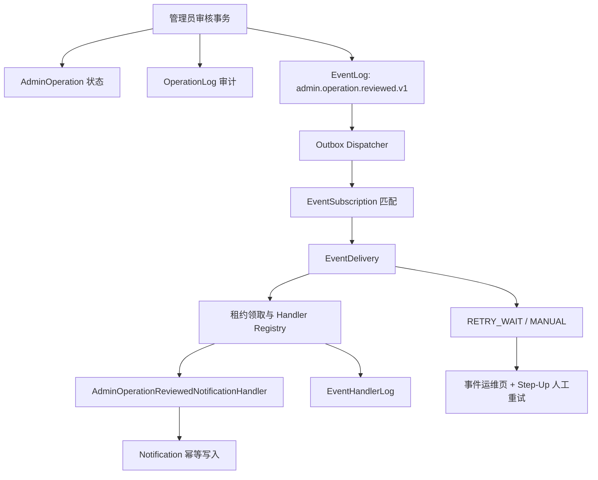

# SPEC-007 可靠事件中心与管理员审核通知设计

> 状态：已完成分节设计确认，等待书面 Spec 复核  
> 日期：2026-07-22  
> 工作区：`D:\2_test\16_ChengyeOA`  
> 实施目录：`LayerManage/law-firm-system`  
> 前置能力：SPEC-001 至 SPEC-006  
> Git 约束：本任务不执行 stage、commit、branch、merge、push、PR 或其他 Git/GitHub 写操作

## 1. 目标

在现有模块化单体和 PostgreSQL 16 基线上建立可靠事件中心，使业务事务提交后，通知、审批、任务、AI、统计和外部集成能够异步执行，同时保证事件不丢失、重复投递不产生重复业务结果、失败可恢复且全过程可审计。

本 Spec 同时落地第一条真实闭环：管理员治理审核事务写入 `admin.operation.reviewed.v1`，后台 Worker 可靠投递，代码注册的通知处理器只为原申请人创建一条站内通知。

## 2. 已批准决策

1. 使用 PostgreSQL Outbox，不引入 Redis、RabbitMQ、Kafka 或其他独立消息基础设施。
2. Worker 运行在 Egg 应用进程内，通过 PostgreSQL 行锁和限时租约支持多实例；另提供一次性 drain CLI。
3. 处理器只允许在代码注册表中声明。数据库订阅只控制启停和白名单过滤条件，不允许动态模块名、表达式脚本或任意代码执行。
4. 本期提供事件运维页面、失败详情和 Step-Up 保护的人工重试。
5. `admin.operation.reviewed.v1` 只通知原申请人，不通知审核人或扩散给全部管理员。
6. 投递语义为 at-least-once，所有处理器必须以稳定幂等键实现业务幂等。
7. 同一 `objectType + objectId` 的顺序敏感事件按处理器串行执行。
8. 生产环境必须显式声明 Worker 是否启用；缺失配置时启动失败，禁止静默不消费。

## 3. 范围

### 3.1 本期包含

- 事件信封、事件类型注册表、payload 校验和敏感字段拒绝规则。
- `EventLog`、`EventSubscription`、`EventDelivery`、`EventHandlerLog` 四个正式模型和加法 migration。
- 事务型 Outbox writer。
- 订阅匹配、投递创建、租约领取、重试、人工队列和对象内有序消费。
- Egg 应用内 Worker 生命周期、健康状态和优雅退出。
- `events:drain` 一次性运维命令。
- 管理员投递概览、列表、详情、订阅读取和人工重试 API。
- Web“事件运维”页面与 Step-Up 重试流程。
- `admin.operation.reviewed.v1` 和站内通知处理器。
- 指标、审计、日志脱敏、备份恢复和故障处置 runbook。
- 完整迁移、并发、恢复、API、Web、验收和泄漏测试。

### 3.2 本期不包含

- 外部消息中间件、跨系统 Webhook、邮件、短信或移动推送。
- 动态处理器代码、动态脚本或任意 SQL 过滤。
- 通用自动化规则引擎。
- 通用审批实例、审批任务和回调中心。
- 动态配置中心及订阅发布/回滚 UI。
- 将线索、合同、收款、案件、文件或 AI 的历史 Controller 一次性全部事件化。
- 删除、跳过、改写 EventLog/payload/attempt 的运维入口。
- EventLog 自动物理删除。本期只保留，归档策略后续独立设计。

## 4. 方案选择

### 4.1 采用：PostgreSQL Outbox + 租约轮询

业务数据、审计和 EventLog 在同一数据库事务提交。调度器使用 `FOR UPDATE SKIP LOCKED` 分派事件，执行器以限时租约领取投递。该方案复用现有 PostgreSQL，部署面最小，并能满足当前规模的可靠性、并发和恢复要求。

### 4.2 未采用：Outbox + LISTEN/NOTIFY

LISTEN/NOTIFY 只能降低正常路径延迟，不能替代持久扫描；仍需处理断线、丢通知和轮询兜底。当前收益不足以覆盖额外连接和恢复复杂度。

### 4.3 未采用：独立消息中间件

外部 Broker 的吞吐和隔离能力更强，但会增加部署、权限、监控、备份和事故处置面。只有在 PostgreSQL Worker 的可测容量不再满足需求时，才另立迁移 Spec。

## 5. 总体架构



Dispatcher 只做短事务：锁定未分派 EventLog、匹配当时已启用订阅、幂等创建 EventDelivery、标记 `dispatchedAt`。Handler Worker 在独立事务中领取和执行投递；业务处理结果与投递成功状态在同一事务完成。

## 6. 事件契约

### 6.1 信封

每个 EventLog 包含：

| 字段 | 规则 |
|---|---|
| `id` | UUID，全局事件 ID |
| `eventType` | 稳定小写点分编码，例如 `admin.operation.reviewed` |
| `eventVersion` | 正整数；本期为 `1` |
| `sourceModule` | 代码注册模块，例如 `ADMIN_GOVERNANCE` |
| `objectType` / `objectId` | 来源业务对象 |
| `orderingKey` | `SHA-256(objectType + ':' + objectId)` 的 64 位小写十六进制摘要 |
| `operatorUserId` | 触发事件的操作者；系统事件允许为空 |
| `organizationId` / `branchId` / `teamId` | 能确定时写入，不能确定时为空，不得伪造 |
| `payload` | Prisma JSON；只允许事件注册表定义的精确结构 |
| `traceId` | 当前 requestId；非请求任务使用生成的安全 trace ID |
| `occurredAt` | 业务决定发生的 UTC 时间 |
| `dispatchedAt` | Dispatcher 成功完成订阅快照后写入 |
| `createdAt` | 数据库写入时间 |

EventLog 创建后不可通过业务服务修改信封或 payload；Dispatcher 只能写 `dispatchedAt`。

### 6.2 注册表

代码注册表为每个事件声明：事件类型、版本、sourceModule、payload 解析器、允许过滤的字段、是否要求对象内有序消费、最大 payload 字节数。未知类型、未知版本、多余字段、原型异常对象、超大 JSON 或不安全值一律拒绝。

禁止字段名采用大小写不敏感的递归检查，至少覆盖：`password`、`secret`、`token`、`authorization`、`cookie`、`csrf`、`totp`、`mfa`、`recoveryCode`、`credential`、`encryptedSecret`、`reason`、`comment`、`oldValues`、`newValues`。字符串值还必须经过现有构建产物泄漏扫描规则。

### 6.3 首个正式事件

`admin.operation.reviewed.v1` 的 payload 精确为：

```ts
interface AdminOperationReviewedV1 {
  operationId: string;
  operationType: GovernedOperationType;
  riskLevel: 'LOW' | 'MEDIUM' | 'HIGH' | 'CRITICAL';
  decision: 'APPROVE' | 'REJECT' | 'CONFIRM' | 'FLAG';
  status: GovernanceStatus;
  requesterUserId: string;
  routeUrl: string;
}
```

`routeUrl` 必须由服务端代码生成并严格等于 `/security/admin-governance?operationId=<UUID>`；不得接受客户端 URL。payload 不包含申请原因、业务 payload、审核评论、目标账号秘密或任何凭据。

实现期一致性修正：治理状态机把 POST-review `CONFIRM` 作为成功审核决定并转换为 `CONFIRMED`；为满足第 8 节“每个成功审核决定均在同一事务写 Outbox”，v1 必须原样表达 `CONFIRM`，不得映射为 `APPROVE` 或跳过事件。

## 7. 数据模型

### 7.1 EventLog

保存第 6 节信封字段。索引至少覆盖 `(dispatchedAt, createdAt)`、`(eventType, eventVersion, createdAt)`、`(objectType, objectId, occurredAt)` 和 `traceId`。

### 7.2 EventSubscription

字段包含 `code`、`eventType`、`eventVersion`、`handlerCode`、`status`、`filterJson`、`createdAt`、`updatedAt`。`code` 唯一，`status` 仅允许 `ENABLED | DISABLED`。

过滤结构只允许：

```ts
interface SubscriptionFilter {
  all: Array<{
    field: string;
    operator: 'EQ' | 'IN';
    values: Array<string | number | boolean>;
  }>;
}
```

字段必须存在于事件注册表的过滤白名单；每个过滤器最多 10 条、每条最多 20 个值、字符串最长 100 字符。不支持 OR、正则、路径表达式、脚本、SQL 或嵌套 payload 路径。

Migration 创建并启用订阅：

- `code`: `admin-operation-reviewed-notification-v1`
- `eventType`: `admin.operation.reviewed`
- `eventVersion`: `1`
- `handlerCode`: `ADMIN_OPERATION_REVIEWED_NOTIFICATION`
- `filterJson`: `null`

本期 API 只读订阅，不提供启停写入口。未来由动态配置中心和治理审核接管。

### 7.3 EventDelivery

字段包含 `eventId`、`subscriptionId`、`handlerCode`、`orderingKey`、`status`、`attemptCount`、`manualRetryCount`、`nextAttemptAt`、`lockedBy`、`lockedUntil`、`lastErrorCode`、`lastErrorReference`、`version`、`startedAt`、`completedAt`、`createdAt`、`updatedAt`。

约束：

- `(eventId, handlerCode)` 唯一。
- `status` 仅允许 `PENDING | PROCESSING | RETRY_WAIT | MANUAL | SUCCEEDED`。
- `attemptCount`、`manualRetryCount` 和 `version` 非负。
- 只有 `PROCESSING` 可同时持有非空 `lockedBy` 和 `lockedUntil`。
- `RETRY_WAIT` 必须有 `nextAttemptAt`；其他终态不得伪造未来执行时间。
- `SUCCEEDED` 必须有 `completedAt`。
- 不提供外键级联删除；事件、订阅、投递和处理日志不得业务删除。

### 7.4 EventHandlerLog

每次执行完成时插入一条不可变记录，包含 `deliveryId`、`attemptNumber`、`workerId`、`outcome`、`errorCode`、`errorReference`、`durationMs`、`startedAt`、`completedAt`。`(deliveryId, attemptNumber)` 唯一。`outcome` 只允许 `SUCCEEDED | RETRY_SCHEDULED | MANUAL_REQUIRED | LEASE_LOST`。进程崩溃不会留下半条日志；其他 Worker 回收过期租约时，必须先为上一 attempt 插入 `LEASE_LOST`，再领取新的 attempt。

日志不保存原始异常、堆栈、payload、数据库连接串或响应正文。

## 8. 事务边界与治理集成

`GovernanceReviewService.review` 在持有 AdminOperation 行锁的现有事务内依次完成：

1. 校验版本、审核人、目标冲突和 Step-Up。
2. 写 AdminOperationReview。
3. 状态转换。
4. 写 OperationLog。
5. 调用 `EventOutboxWriter.append(tx, envelope)` 写 `admin.operation.reviewed.v1`。
6. 提交事务。

任一步失败时状态、审核、审计和事件全部回滚。事件不能在事务提交后通过 fire-and-forget sink 补写。

本期只把成功形成审核决定的路径升级为正式领域事件。自审拒绝、目标冲突和参数错误没有业务状态变化，不创建 EventLog，继续由安全审计记录。现有 `OPERATION_CREATED`、`EXECUTION_SUCCEEDED` 等内部观察字符串不自动升级为公共事件契约；测试所需 observer 与正式 Outbox 接口分离。

## 9. Dispatcher 与 Worker

### 9.1 Dispatcher

单批最多处理配置上限内的未分派 EventLog。它在短事务内使用 `FOR UPDATE SKIP LOCKED`，读取已启用订阅快照，验证 handlerCode 和 filter，再以唯一约束创建 EventDelivery。

如果订阅引用未注册处理器或过滤配置已损坏，Dispatcher 为该订阅创建 `MANUAL` 投递，错误码为 `HANDLER_NOT_REGISTERED` 或 `SUBSCRIPTION_FILTER_INVALID`，并将 Worker 健康状态标为 degraded；不得静默跳过。

即使当前没有匹配订阅，也将 EventLog 标记 `dispatchedAt`，代表已按当时订阅快照完成分派。后续新增订阅不会追溯消费历史事件，除非未来另立受控 replay 设计。

### 9.2 投递领取

Worker 从 `PENDING`、到期 `RETRY_WAIT` 或租约已过期的 `PROCESSING` 中领取。领取事务使用 `FOR UPDATE SKIP LOCKED`，写入：

- `status = PROCESSING`
- `lockedBy = workerId`
- `lockedUntil = now + 60 seconds`
- `attemptCount += 1`
- `startedAt = now`
- `version += 1`

同一 `handlerCode + orderingKey` 存在更早未成功投递时，后续投递不可领取。只有 `SUCCEEDED` 解除顺序阻塞；`MANUAL` 必须持续阻塞同一对象的后续事件，直到人工重试成功。运维概览必须把这种阻塞计入告警，禁止为提升吞吐而绕过顺序。

### 9.3 执行与租约校验

处理器事务提交前必须再次校验 delivery ID、version、workerId、PROCESSING 状态和未过期租约。只有当前租约持有者能写业务结果、EventHandlerLog 和投递结果。

业务幂等写入和 `SUCCEEDED` 状态在同一事务中完成。若进程在事务提交前退出，全部回滚；若提交成功后退出，投递已是 SUCCEEDED，不会再次执行业务结果。

### 9.4 重试

失败后的固定计划：

| 失败的 attemptNumber | 结果 |
|---:|---|
| 1 | 15 秒后 `RETRY_WAIT` |
| 2 | 5 分钟后 `RETRY_WAIT` |
| 3 | 1 小时后 `RETRY_WAIT` |
| 4 | 6 小时后 `RETRY_WAIT` |
| 5 及以上 | `MANUAL` |

`RetryableEventError(code)` 进入上述计划；`PermanentEventError(code)` 立即进入 MANUAL。未知异常视为 retryable，但只持久化 `EVENT_HANDLER_UNKNOWN` 和随机错误引用。人工重试不清零历史 attemptCount，只增加 manualRetryCount；若下一次仍失败，立即回到 MANUAL。

## 10. 生命周期与配置

Egg `didReady` 创建并启动单个 EventWorker，`beforeClose` 停止领取并等待在途处理最多 30 秒。定时器调用 `unref`，不得阻止进程退出。未完成工作保留租约，由其他实例或重启实例在租约到期后恢复。

配置：

| 环境变量 | 默认与约束 |
|---|---|
| `EVENT_WORKER_ENABLED` | production 必填 `true|false`；development 默认 true；unittest 默认 false |
| `EVENT_WORKER_POLL_MS` | 默认 1000；范围 250–60000 |
| `EVENT_WORKER_BATCH_SIZE` | 默认 25；范围 1–200 |
| `EVENT_WORKER_LEASE_SECONDS` | 默认 60；范围 30–600 |
| `EVENT_WORKER_SHUTDOWN_SECONDS` | 默认 30；范围 1–120，且小于租约秒数 |

配置解析沿用 `config/env.ts` 的 fail-closed 方式。生产缺少 `EVENT_WORKER_ENABLED`、格式错误或范围越界时应用拒绝启动。

数据库连续不可用时 Worker 使用 1、2、5、10、30 秒上限退避。HTTP 主进程不因一次瞬态 Worker 失败退出，但 Worker 健康状态变为 degraded；恢复数据库连接后自动继续。

## 11. 处理器注册与通知幂等

处理器注册表使用稳定 `handlerCode` 映射到构造函数和支持的事件类型/版本。注册项必须唯一，应用启动时验证代码注册表内部一致性。

`AdminOperationReviewedNotificationHandler`：

1. 解析并验证 v1 payload。
2. 查找原申请人和治理操作；缺失或不一致时抛 `PermanentEventError('GOVERNANCE_SOURCE_INVALID')`。
3. 生成不含原因、评论和敏感 payload 的标题/正文。
4. 生成 `deduplicationKey = SHA-256(eventId + handlerCode + requesterUserId)`。
5. 在当前投递事务创建 Notification；唯一键已存在且字段一致时视为幂等成功，不一致时进入 MANUAL。
6. `routeUrl` 只使用已验证的 payload 值。

Notification 增加 `deduplicationKey String? @unique` 和 `routeUrl String?`。字段保持 nullable 以兼容既有通知；事件处理器创建的通知必须同时提供两者。

## 12. 权限、Step-Up 与审计

新增权限：

| 权限 | 风险 | 授权边界 |
|---|---|---|
| `menu.event_operations` | HIGH | 显示 `/security/event-operations` |
| `event.delivery.read` | HIGH | 系统管理员、超级管理员按正式角色授权 |
| `event.delivery.retry` | CRITICAL | 第一版仅超级管理员角色拥有 |

人工重试要求 MFA 会话和一次性 `EVENT_DELIVERY_RETRY` Step-Up。目标精确为：

```ts
{ deliveryId: string; expectedVersion: number }
```

重试事务锁定 delivery，验证 `MANUAL`、expectedVersion 和当前无租约，消费 Step-Up，更新为 PENDING，清空错误展示字段和租约字段，增加 manualRetryCount/version，并写 `EVENT_DELIVERY_MANUAL_RETRY` 审计。审计只保存 deliveryId、eventType、handlerCode、原 attemptCount 和新的 version，不保存 payload 或错误原文。审计失败则全部回滚。

## 13. 管理 API

基础路径 `/api/v1/event-operations`：

| 方法与路径 | 权限 | 行为 |
|---|---|---|
| `GET /summary` | `event.delivery.read` | 返回各状态数量、成功率、最长积压秒数和 Worker 健康摘要 |
| `GET /deliveries` | `event.delivery.read` | 按状态、事件类型、处理器、对象和时间筛选 |
| `GET /deliveries/:id` | `event.delivery.read` | 返回脱敏信封摘要、投递和尝试时间线 |
| `GET /subscriptions` | `event.delivery.read` | 只读订阅状态和安全过滤摘要 |
| `POST /deliveries/:id/retry` | `event.delivery.retry` + Step-Up | 人工重试 MANUAL 投递 |

分页从 1 开始，默认 20，最大 200；排序字段使用白名单。不存在和无权限目标统一按现有授权策略隐藏。接口不返回完整 payload、原始异常、堆栈、workerId、lockedBy、数据库信息或处理器内部结构。

详情的 payloadSummary 由事件类型注册表生成，只包含允许展示的标量字段。错误只返回稳定 `lastErrorCode`、`lastErrorReference` 和时间。

## 14. Web 事件运维页

路由 `/security/event-operations`。无菜单权限不显示入口，直接访问仍由服务端权限兜底。

页面包含：

- PENDING、RETRY_WAIT、MANUAL、SUCCEEDED 数量。
- 最近 24 小时成功率和最长积压时间。
- 状态、事件类型、处理器、对象和时间筛选。
- 投递详情抽屉：安全事件摘要、attempt 时间线、下次执行时间和错误引用。
- MANUAL 投递的“人工重试”按钮。
- Step-Up 对话框明确提示将重新执行业务处理器，令牌只保存在组件内存并立即消费。

页面不提供删除、跳过、改写 payload、修改 attempts、编辑订阅或批量重放。

## 15. Worker 运维命令

新增：

```text
npm.cmd --prefix apps/server run events:drain
```

命令校验 PostgreSQL URL、migration 状态、代码注册表和订阅配置，使用与应用相同的 Dispatcher/Worker 服务，循环处理当前到期任务，直到连续两轮无可处理项后退出。drain 是显式运维动作，因此即使 `EVENT_WORKER_ENABLED=false` 也允许运行，但其余 Worker 配置仍必须有效。它只输出：分派数、领取数、成功数、重试数、MANUAL 数和安全错误引用。

CLI 不输出 payload、Notification 内容、连接串、handler 异常或内部主键列表。未知处理器/事件版本会生成 MANUAL 证据并以非零退出，避免运维误判为全部成功。

## 16. 可观测性

内存健康快照至少包含：Worker 是否启用、最后成功 tick、最后数据库失败时间、连续数据库失败数和安全错误引用。summary API 不暴露实例标识。

结构化指标：

- `event_outbox_undispatched_total`
- `event_delivery_total{status,eventType,handlerCode}`
- `event_delivery_latency_seconds`
- `event_delivery_attempt_total{outcome,errorCode}`
- `event_worker_database_failure_total`
- `event_delivery_manual_total`

如果当前项目尚无指标采集器，本期先由 Worker health service 和 summary API 提供同构数据，不引入新监控依赖；字段命名保持将来接 Prometheus 的兼容性。

## 17. 安全与隐私

- EventLog、Delivery、HandlerLog 和 Notification 均纳入 SPEC-006 构建产物泄漏扫描。
- payload 只接受普通 JSON 对象；拒绝原型对象、函数、BigInt、循环引用和非有限数字。
- payload 序列化后上限 16 KiB；通知标题上限 120 字符，正文上限 1000 字符，routeUrl 上限 500 字符。
- 所有错误持久化前映射到稳定错误码和随机引用。
- Worker 日志不得调用未知异常的 raw message/stack；调试需要通过错误引用关联受控内部遥测。
- EventLog、HandlerLog 和人工重试审计不提供业务删除接口。
- 管理页面不得成为查看治理原因、审核评论或业务 payload 的旁路。

## 18. 测试策略

### 18.1 Migration 和数据库契约

- 四张表、Notification 扩展、权限、订阅和所有索引/唯一/检查约束。
- migration 只能加法演进，重复 deploy 安全。
- schema model 数和空库断言同步更新。

### 18.2 领域与 Store

- 信封精确字段、版本、payload 上限和递归敏感字段拒绝。
- filter 白名单、边界数量和非法结构。
- EventLog 与治理事务同时提交/回滚。
- Dispatcher 并发只创建一次 Delivery。
- 两个 PrismaClient/Worker 并发领取只产生一个当前租约持有者。
- 租约过期恢复、版本冲突、对象内有序、MANUAL 持续阻塞及人工成功后的解阻塞。
- 15 秒、5 分钟、1 小时、6 小时重试边界。

### 18.3 Handler 和 Worker

- 重复通知事件只产生一条 Notification。
- 处理器业务写入失败时投递成功状态回滚。
- retryable、permanent、unknown 和 lease lost 的确定性结果。
- graceful shutdown 不领取新任务，在途超时后由租约恢复。
- unittest 自动 Worker 默认关闭，手动 tick 可重复控制。

### 18.4 API 和 Web

- 普通用户、无权限管理员和越权详情统一拒绝。
- 最大分页、筛选和排序白名单。
- API/页面不出现完整 payload、workerId 或 raw error。
- MANUAL 重试绑定 deliveryId/version，跨目标、过期、重复 Step-Up 全拒绝。
- 菜单、统计卡片、筛选、详情、Step-Up 和刷新流程。

### 18.5 验收

1. 创建受控管理员治理申请。
2. 另一位超级管理员审核。
3. 同事务存在状态、审核、OperationLog 和 `admin.operation.reviewed.v1`。
4. Worker 分派并处理事件。
5. 原申请人只收到一条通知，路由指向该治理操作。
6. 重复 tick、重复领取和重启不产生第二条通知。
7. 注入 retryable 失败，观察四级重试计划。
8. 第五次失败进入 MANUAL。
9. 超级管理员完成 Step-Up 人工重试并留下审计。
10. 清理受控业务对象前验证事件、投递、处理日志和审计均不泄漏凭据。

## 19. 发布

1. 备份 PostgreSQL 并验证隔离恢复点。
2. 生产显式配置 `EVENT_WORKER_ENABLED=false`。
3. 应用加法 migration。
4. 发布同一审核版本的 Server 和 Web。
5. 创建并审核一条受控治理记录。
6. 运行 `events:drain`，验证事件、投递和唯一通知。
7. 将 `EVENT_WORKER_ENABLED=true` 并滚动重启。
8. 观察积压、失败率、最长延迟和租约恢复。
9. 验证事件运维页和 Step-Up 人工重试。
10. 删除受控业务数据；保留不可删除的脱敏事件、投递、处理日志和审计证据。

## 20. 回滚与故障处置

回滚先把 Worker 关闭，再回滚应用。事件表不做破坏性回滚，EventLog、Delivery 和 HandlerLog 保留。修复后的同版本兼容 Worker 从现有状态继续消费。

处理器缺陷时通过受控数据库订阅状态暂停该 handler；本期没有启停 API，必须使用经审核的运维变更并记录证据。不得删除投递或改 payload。数据库恢复后租约自动过期并继续；密集失败达到 MANUAL 后由事件运维页处理。

备份恢复演练必须同时验证：未分派 EventLog、RETRY_WAIT、MANUAL、SUCCEEDED、HandlerLog、Notification 幂等键和订阅状态能够恢复，恢复环境 Worker 默认关闭，显式验证后才能 drain。

## 21. 完成定义

SPEC-007 只有在以下条件全部满足时完成：

1. 所有批准的数据模型、约束、权限、API、页面、Worker 和 CLI 已实现。
2. 正式治理审核事件在业务事务内写入，不再依赖事务外尽力发送。
3. 管理员审核通知闭环在真实 PostgreSQL 上通过。
4. 并发领取、租约恢复、幂等、顺序、重试和 MANUAL 人工恢复均有自动化证据。
5. Server/Web lint、typecheck、全量测试、真实 c8、生产构建、生产依赖门禁、泄漏扫描和空测试库断言通过。
6. 应用内 Worker 和 `events:drain` 均完成真实演练。
7. PostgreSQL 备份恢复覆盖至少一个未终结投递和一个已成功通知，恢复后不产生重复通知。
8. runbook、handoff 和 closeout 记录脱敏命令、测试数、覆盖率、演练结果和已知非阻断风险。
9. 独立代码审阅无 Critical 或 Important 未解决问题。
10. 全过程不执行任何 Git/GitHub 写操作。
