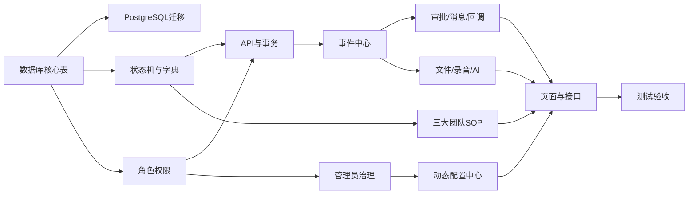

# 承业律所综合管理 OA 专项设计索引

> 当前权威需求：[需求总纲](../spec/README.md)；原 `../../律所闭环管理系统需求开发文档.md` 为历史来源
> 基线版本：V1.0  
> 建立日期：2026-07-11  
> 用途：历史设计追溯；当前开发基线见下方说明

## 1. 当前效力与使用规则（2026-11-06）

本目录正文主要为2026年7月至9月的设计输入，保留作历史追溯。当前功能、权限、字段和流程已按代码重新整理，见 [当前Spec](../spec/README.md)、[差异清单](../spec/CHANGES-2026-11-06.md)及 [技术参考](../spec/TRACE.md)。

- 与当前成果冲突时，使用当前MOD/FTN及源码参考，不再以旧表结构、旧接口或旧审批模式要求改回代码。
- 已完成工程报告保留当时事实；当前清单不把历史所有设计自动标记为完成。
- 表/字段/路由/权限编码分别查当前模型、字段、接口和权限附录。旧设计中的统一响应、全量字段和全量状态目标不代替实际服务校验。
- 未来功能改动须同步当前规格和相关技术参考；本次不改变运行系统。

## 2. 文档清单

| 序号 | 文档 | 主要用途 | 前置依赖 |
|---:|---|---|---|
| 1 | [数据库核心表设计草案.md](数据库核心表设计草案.md) | 表域、关系、约束、索引与数据规范 | PRD |
| 2 | [角色权限与数据范围设计.md](角色权限与数据范围设计.md) | RBAC、数据范围、字段权限、特殊权限 | 数据库设计 |
| 3 | [页面与接口清单.md](页面与接口清单.md) | 页面路由、操作、接口和权限映射 | 数据库、权限、API |
| 4 | [PostgreSQL迁移方案.md](PostgreSQL迁移方案.md) | SQLite 到 PostgreSQL 迁移和回滚 | 数据库设计 |
| 5 | [三大专业团队SOP系统字段清单.md](三大专业团队SOP系统字段清单.md) | 医疗、执行、刑事 SOP 字段与模板 | 状态机、配置中心 |
| 6 | [状态机与业务字典设计.md](状态机与业务字典设计.md) | 核心对象状态、转换与字典编码 | 数据库设计 |
| 7 | [API规范错误码与事务边界设计.md](API规范错误码与事务边界设计.md) | API 契约、错误码、幂等和事务 | 数据库、状态机、权限 |
| 8 | [审计日志与自动化规则设计.md](审计日志与自动化规则设计.md) | 审计、规则触发、重试与人工处理 | 事件、审批、权限 |
| 9 | [数据流转事件中心设计.md](数据流转事件中心设计.md) | Outbox、事件订阅、投递与幂等 | 数据库、API |
| 10 | [审批实例任务与消息回调设计.md](审批实例任务与消息回调设计.md) | 审批、待办、消息、同步回调 | 事件、权限 |
| 11 | [系统管理员与超级管理员权限设计.md](系统管理员与超级管理员权限设计.md) | 管理员职责分离和高风险审核 | 权限、审计、审批 |
| 12 | [动态字段表格与模板配置设计.md](动态字段表格与模板配置设计.md) | 元数据配置、版本、发布和回滚 | 数据库、管理员权限 |
| 13 | [文件录音AI任务设计.md](文件录音AI任务设计.md) | 文件存储、转写、AI 提取和安全 | 权限、事件、API |
| 14 | [测试验收用例清单.md](测试验收用例清单.md) | 测试范围、主链路和发布门禁 | 全部专项设计 |

## 3. 建议开发依赖顺序

## 4. 通用约定

- 数据库表名、字段名、API 路径、事件类型使用英文；页面和业务字典显示中文。
- 主键使用 UUID；时间统一存储 UTC，前端按 Asia/Shanghai 展示。
- 核心业务数据默认软删除，审计日志、事件日志和审批记录不可业务删除。
- 所有写操作必须携带操作者、组织范围、请求追踪 ID；关键写操作支持幂等。
- L3/L4 数据必须经过字段权限和审计校验。
