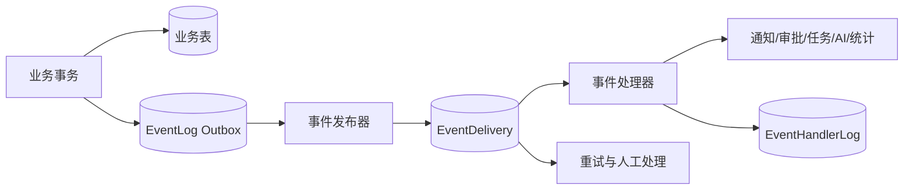

> **历史设计说明（2026-11-06）**：本文保留原设计输入；当前OA行为、权限、字段、API和审批模式以 [现行Spec](../spec/README.md) 及 [差异清单](../spec/CHANGES-2026-11-06.md) 为准。下文计划或旧规则不覆盖当前实现。

# 数据流转事件中心设计

## 1. 目标

在模块化单体内建立可靠事件中心，解耦通知、审批、任务、AI、统计和外部集成，同时保证业务写入与事件不丢失。

## 2. 架构

第一版使用 PostgreSQL Outbox + 后台任务，不引入独立消息中间件；未来可替换发布器而不改变事件契约。

## 3. 事件信封

| 字段 | 说明 |
|---|---|
| eventId | 全局唯一 ID |
| eventType | `domain.object.action` |
| eventVersion | 事件结构版本 |
| occurredAt | 业务发生时间 |
| sourceModule | 来源模块 |
| objectType/objectId | 来源对象 |
| operatorId | 操作人或 system |
| organizationId/branchId/teamId | 数据归属 |
| payload | 最小必要载荷 |
| traceId | 链路追踪 |

事件 payload 不放完整 L4 文件、录音和证据内容，只传对象 ID 与必要摘要。

## 4. 核心事件

| 事件 | 主要消费者 |
|---|---|
| lead.created、lead.assigned | 去重、分配、首响、通知、统计 |
| appointment.created、appointment.visited | 日程、谈案任务、录音登记 |
| audio.uploaded、audio.transcribed | 转写、AI 提取 |
| contract.first_signed | 应收、材料任务、分析委托 |
| contract.formal_signed | 应收、案件、风险告知 |
| payment.confirmed | 合同、客户全景、驾驶舱 |
| matter.created、matter.task.completed、matter.closed | SOP、质控、满意度、复盘 |
| survey.low_score | 管委会专项分析和通知 |
| config.published | 配置缓存、页面、权限和自动化刷新 |
| admin.operation.reviewed | 配置或干预后续动作 |

## 5. 订阅与过滤

EventSubscription 包含 subscriberCode、eventType、eventVersion、filter、handlerCode、status。过滤只允许使用白名单字段，禁止执行动态脚本。

## 6. 投递与重试

1. 发布器按 EventLog ID 顺序扫描未发布记录并创建 EventDelivery。
2. 消费者以 eventId + handlerCode 建立唯一约束。
3. 重试建议：15 秒、5 分钟、1 小时、6 小时；超过上限进入 MANUAL。
4. 对同 objectType + objectId 的顺序敏感事件串行消费。
5. 人工重试必须记录操作人、原因和结果。

## 7. 失败处理

| 类型 | 处理 |
|---|---|
| 临时网络/服务错误 | 自动重试 |
| 权限或配置缺失 | 进入人工处理并通知管理员 |
| 事件版本不支持 | 停止消费，标记版本错误 |
| 业务状态已变化 | 幂等检查后忽略或进入冲突处理 |
| 数据格式错误 | 保留原事件，记录错误，不修改 payload |

## 8. 可观测性

- 指标：待投递数、成功率、失败率、平均延迟、重试数、人工队列数。
- 查询：按 eventId、objectId、traceId、eventType 查看完整链路。
- 告警：连续失败、积压超阈值、有序事件阻塞、MANUAL 数量增长。

## 9. 验收

- 业务事务回滚时 EventLog 不得残留；事务成功时 EventLog 必须存在。
- 重复投递不产生重复应收、案件、通知或统计。
- 处理器失败不阻塞原业务请求。
- 有序事件能够按对象顺序消费和恢复。

