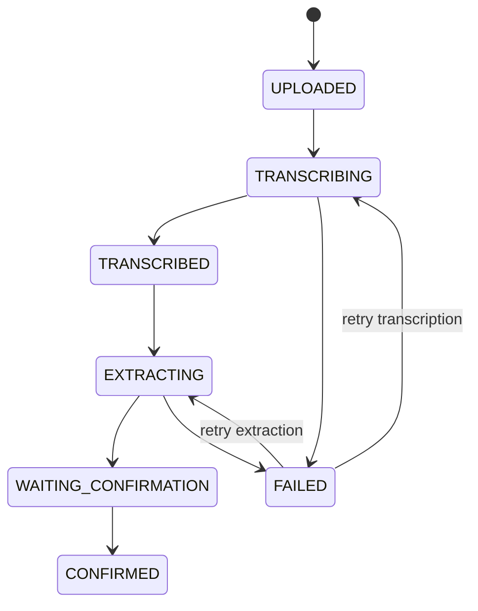

> **历史设计说明（2026-11-06）**：本文保留原设计输入；当前OA行为、权限、字段、API和审批模式以 [现行Spec](../spec/README.md) 及 [差异清单](../spec/CHANGES-2026-11-06.md) 为准。下文计划或旧规则不覆盖当前实现。

# 文件、录音与 AI 任务设计

## 1. 文件服务

业务表只保存 FileObject ID，不保存绝对物理路径。FileStorageAdapter 支持 local 和 object 两种驱动。

| FileObject 字段 | 说明 |
|---|---|
| id | 文件 ID |
| originalName/storageKey | 原名与存储键 |
| mimeType/size/hash | 类型、大小、SHA-256 |
| storageDriver | local/object |
| sensitivityLevel | L1-L4 |
| objectType/objectId | 关联业务对象 |
| uploaderId/createdAt | 上传人和时间 |
| status | UPLOADING、AVAILABLE、QUARANTINED、ARCHIVED、DELETED |

## 2. 上传与下载

1. 上传初始化生成 FileObject 和上传凭证。
2. 上传完成校验大小、Hash、类型和安全扫描结果。
3. 具备对象可见范围的用户默认可下载，但 L3/L4 需特殊权限和审计。
4. 对象存储使用短时签名 URL；本地存储使用鉴权流式下载。
5. 删除默认归档或软删除，不物理删除被合同、案件、审计引用的文件。

## 3. 录音模型

AudioRecording 记录设备、谈案人、客户、线索、案件、开始/结束时间、文件、转写状态、同意/告知记录和数据级别。

支持人工上传和实时转写。实时音频按会话 ID 分段，结束后合并为最终录音和文本版本。

## 4. AI 供应商适配

统一接口：submitTranscription、getTranscription、extractFacts、healthCheck。分别实现 FalAdapter 和 DashScopeAdapter，不强制兼容 OpenAI 协议。

环境变量：

```env
AI_PROVIDER=dashscope
FAL_AI_BASE_URL=<deployment-value>
FAL_AI_MODEL=<deployment-value>
FAL_AI_API_KEY=<secret>
DASHSCOPE_BASE_URL=<deployment-value>
DASHSCOPE_MODEL=<deployment-value>
DASHSCOPE_API_KEY=<secret>
FILE_STORAGE_DRIVER=local
FILE_STORAGE_ROOT=<deployment-path>
OBJECT_STORAGE_ENDPOINT=<deployment-value>
OBJECT_STORAGE_BUCKET=<deployment-value>
OBJECT_STORAGE_ACCESS_KEY=<secret>
OBJECT_STORAGE_SECRET_KEY=<secret>
```

密钥只从环境变量读取，不入库、不写日志、不返回前端。

## 5. 任务流



TranscriptionJob 与 AiExtractionResult 分开建模，避免其中一步失败导致全部重做。

## 6. AI 提取结构

- 客户诉求、案件事实、时间线、人员和机构。
- 证据及缺失材料、争议焦点、风险、客户关注点。
- 建议下一步、待确认问题、专业团队分类建议。

AI 输出始终标记模型、提示词版本、生成时间和置信说明。人工修订形成新版本；确认前不得自动改变合同、案件、收款和正式法律结论。

## 7. 安全与隐私

- 录音、刑事材料和案件事实默认 L4。
- 发送外部模型前执行最小必要传输并记录供应商、模型和数据范围。
- API 请求/响应日志只保存脱敏摘要，不保存完整录音或证据正文。
- 下载、外发、AI 调用、人工修订和确认全部审计。

## 8. 重试与可观测性

- 临时错误指数退避重试，超过上限进入人工处理。
- 指标：上传成功率、转写耗时、提取耗时、失败率、重试数、人工确认时长、供应商健康度。
- 供应商不可用时允许切换适配器，但不得重复生成已确认业务结果。

## 9. 验收

- 本地和对象存储均通过上传、下载、归档和权限测试。
- 上传转写、实时转写、失败重试和供应商切换可验证。
- AI 原始结果、人工修订和确认版本可追溯。
- 无权限用户不能访问录音、文本或 AI 提取结果。

