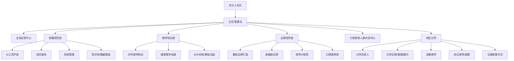
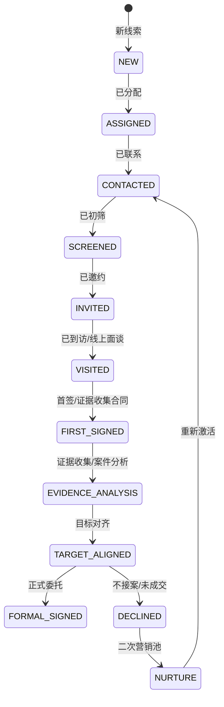
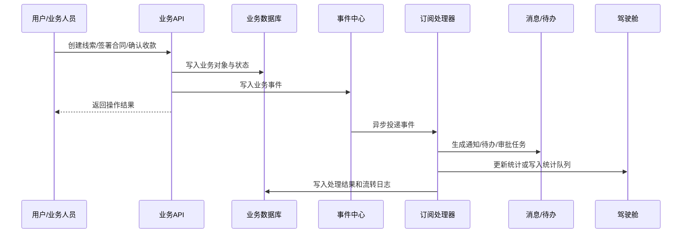
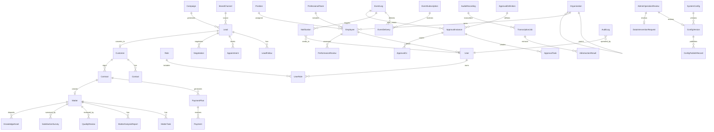

# 承业律师事务所综合管理 OA 系统 PRD

> **迁移声明（2026-07-28）**：本文件的需求明细已按 `docs/spec/CONVENTIONS.md` 规范拆分迁移至 `docs/spec/`（业务模块 `modules/MOD-001~013`、横切契约 `foundations/FTN-001~007`、追溯矩阵 `TRACE.md`、总纲 `README.md`）。本文件保留全文作为历史基线，后续需求变更以 `docs/spec/` 为权威来源，不再维护本文件的明细内容。

> 文档版本：V1.0 需求基线版  
> 日期：2026-07-11  
> 文档状态：可进入数据库、权限、接口、页面和测试专项设计  
> 适用对象：重庆承业律师事务所综合管理 OA / 经营闭环系统  
> 文档用途：作为后续数据库设计、接口设计、页面设计、权限设计、测试验收和代码开发的统一需求依据  
> 依据材料：前序需求讨论稿、`律所管理系统PRD.docx`、`承业律师事务所整体发展框架设计方案.docx`、LayerManage / LawLink / LexNebulis 源码分析结论、飞书开放平台数据流转机制参考  

---

## 1. 文档目标

本文档将承业律师事务所综合管理 OA 系统需求收敛为一份完整 PRD，重点回答：

1. 系统要解决什么经营问题。
2. 系统覆盖哪些组织、角色、业务链路和数据对象。
3. 各业务模块需要实现哪些功能。
4. 核心对象如何流转、如何关联、如何授权、如何审计。
5. 后续开发应按什么边界拆数据库、接口、页面和测试用例。

本文档不是路线图文档，不以阶段拆分为主线。凡写入“本 PRD 范围”的内容，均作为后续开发设计依据；凡写入“暂不纳入本 PRD”的内容，后续另行立项或扩展。

---

## 2. 产品定位

承业综合管理 OA 系统是一套服务律所“大中台 + 小前台”组织模式的经营闭环系统，不是单一 CRM、单一案件系统或单一行政 OA。

系统需要把律所行政、财务、人事、品牌运营、网络流量管理、客服邀约、谈案签约、律师办案交付、质量控制、客户复购转介绍全部串联起来，形成从“获客”到“签约”再到“办案交付”和“复购转介绍”的完整闭环。

核心闭环如下：


---

## 3. 建设目标

### 3.1 经营目标

1. 管理层可以实时查看总所、分所、部门、专业团队、岗位和个人的经营情况。
2. 线索、客户、合同、回款、案件、质控、满意度、复盘、转介绍形成完整数据链路。
3. 总所沉淀知识、专家能力、AI 能力、培训能力、品牌能力和质量控制能力。
4. 分所承接市场接待、证据收集、诉讼服务、客户维护等前端执行工作。
5. 医疗纠纷、执行、刑事辩护三大专业团队形成标准化 SOP，并为后续其他专业团队预留分类和扩展能力。

### 3.2 系统目标

1. 以 `LayerManage` 为经营 OA 基座进行二次开发。
2. 开发前将现有 SQLite 数据库切换到 PostgreSQL。
3. 吸收 `LawLink` 的案件交付、法律专业能力、文档归档、用章和 AI 法律工具设计思想。
4. 参考 `LexNebulis` 的安全、审计、客户门户、企业身份和集成能力。
5. 采用“模块化单体 + 清晰领域边界”的工程模式，避免过早微服务化。
6. 建立统一主数据、状态机、权限、审计、自动化、文件和 AI 任务底座。
7. 参考飞书开放平台的数据流转方式，建立“资源对象 API + 事件订阅 + 同步回调 + 审批任务 + 消息通知”的内部协同机制。

### 3.3 产品验收目标

1. 任一有效线索均可追溯来源、负责人、跟进、邀约、谈案、合同、收款和案件去向。
2. 任一客户均具备唯一客户主档，重复客户可识别、合并并保留原始关联映射。
3. 首签/证据收集合同和正式委托合同可独立审批、签署、收款、终止和审计。
4. 医疗纠纷、执行、刑事辩护业务均可按配置的 SOP 完成任务、材料、分析、审核和复盘。
5. 总所、分所、专业团队和个人数据必须按权限隔离，越权访问测试不得出现敏感数据泄露。
6. 所有关键状态变化均可从业务对象、事件日志、审批任务和审计日志还原完整过程。
7. 系统管理员配置变更可版本化、审核、发布和回滚，高风险操作未经超级管理员审核不得生效。
8. 驾驶舱可按日、周、月展示一致口径的经营、财务、交付、质控和品牌指标。

---

## 4. 本 PRD 范围

### 4.1 纳入范围

本 PRD 覆盖以下能力：

| 领域 | 覆盖内容 |
|---|---|
| 组织权限 | 总所、分所、部门、专业团队、岗位、员工、账号、角色、权限、数据范围 |
| 系统配置 | 逻辑表格、动态字段、视图、模板、字典、状态机、SOP、自动化规则、版本发布和回滚 |
| 品牌运营 | 渠道、内容、律师 IP、投放计划、线索归因、品牌素材 |
| 线索销转 | 线索、公海/私海、分配、跟进、邀约、到访、谈案、未成交复盘 |
| 客户主数据 | 客户、联系人、转介绍关系、去重合并、客户标签 |
| 合同财务 | 首签/证据收集合同、正式委托合同、合同模板、编号规则、审批流、电子签入口、应收、收款、开票、退款、成本 |
| 专业团队 | 医疗纠纷、执行、刑事辩护三大团队 SOP，其他团队分类预留 |
| 案件交付 | 轻量案件建档、节点任务、材料、沟通、专家指导、文书审核、结案 |
| 质量知识 | 质量审核、满意度、低满意度专项分析、复盘、知识资产、品牌案例 |
| AI 协同 | 胸牌录音登记、人工上传、实时转写、AI 要点提取、人工修订、供应商适配 |
| 组织人事 | 员工档案、岗位、考勤、请假、培训、绩效、价值观记录、设备领用 |
| 驾驶舱 | 日、周、月经营指标、团队指标、财务指标、交付指标、品牌指标 |
| 自动化 | 线索提醒、材料提醒、报告提醒、回款提醒、客户告知、低满意度触发、通知、审计 |
| 数据流转 | 业务事件、事件订阅、事件投递、同步回调、审批实例、任务处理、消息卡片式操作 |

### 4.2 暂不纳入范围

以下内容不纳入本 PRD 的开发范围，但保留数据和接口扩展位：

1. 分所独立核算、分账、提成自动结算。
2. 复杂薪酬、福利、社保、公积金、招聘 ATS。
3. 客户门户完整功能。
4. 电子签平台深度集成，仅预留签署入口、签署流水号、签署状态和回调字段。
5. 电话系统、企业微信、广告平台的深度集成，仅预留外部来源和接口。
6. 完整案件管理系统中的一案多程序、期限、快递、保全、归档等深度案管能力。
7. 哈希链审计、SSO、SCIM、WebAuthn、SIEM/SOAR 等高级企业安全能力。
8. 本地大模型部署。

---

## 5. 用户角色与组织模型

### 5.1 组织模型

系统支持“总所大中台 + 分所小前台”的组织模型。



### 5.2 关键角色

| 角色 | 核心职责 |
|---|---|
| 系统超级管理员 | 拥有系统管理员全部权限，并负责审核系统管理员的高风险配置变更、数据干预、权限调整和逻辑表格/字段配置变更 |
| 系统管理员 | 管理逻辑表格、资料、动态字段、模板、字典、状态机、SOP 节点、自动化规则和系统配置；可通过受控接口对系统各环节进行必要干预 |
| 合伙人/管委会 | 查看经营驾驶舱、重大事项审批、质量抽检、低满意度专项分析 |
| 主任/管理层 | 管理总所与分所经营目标、团队绩效、资源调配 |
| 前瞻研究部 | 系统管理、AI 工具、技术服务、知识库、数据看板 |
| 律师培训部 | 分所律师培训、疑难案件处理、SOP 训练、专家指导 |
| 品牌宣传部 | 品牌宣传、内容引流、律师 IP、满意度调查、口碑案例库 |
| 分所负责人 | 管理本分所线索、客户、合同、案件、人员和经营数据 |
| 运营/投放人员 | 管理渠道、内容、投放计划、线索归因和 ROI |
| 客服 | 线索初筛、首响、咨询记录、客户标签 |
| 邀约人员 | 邀约计划、到访确认、爽约处理、二次邀约 |
| 谈案律师 | 谈案记录、报价、首签、目标对齐、正式委托 |
| 专业团队负责人 | 管理专业 SOP、分析报告、专家指导、质量审核 |
| 承办律师/助理 | 案件建档、节点任务、文书、沟通、结案复盘 |
| 财务 | 应收、实收、开票、退款、减免、成本统计 |
| 人事 | 员工、岗位、考勤、请假、培训、绩效确认 |

### 5.3 角色权限矩阵

下表作为后续 RBAC、数据范围和特殊权限设计的基线。`管理`表示可增改删查并执行业务动作，`审核`表示可处理审批或复核，`查看`表示只读，未列明的权限默认不授予。

| 角色 | 默认数据范围 | 核心权限 | 关键限制 |
|---|---|---|---|
| 系统超级管理员 | 全所 | 拥有系统管理员全部权限；审核系统管理员高风险操作；管理系统管理员账号和授权 | 不得审核本人发起的操作；不得关闭审计；关键操作全量留痕 |
| 系统管理员 | 全所 | 管理配置中心、组织权限、模板字典、状态机、SOP、自动化规则；执行经授权的数据干预 | 不得给本人提权；不得创建或授权超级管理员；不得审核本人操作；不得直接修改数据库物理结构 |
| 合伙人/管委会 | 全所或授权范围 | 查看经营数据、重大事项审批、质量抽检、低满意度专项分析 | 不默认维护技术配置和原始审计数据 |
| 主任/管理层 | 全所或分管范围 | 经营目标、资源调配、团队绩效、业务审批、驾驶舱 | 敏感案件材料按字段权限控制 |
| 前瞻研究部 | 授权的跨分所范围 | AI 工具、知识库、数据看板、技术服务 | 系统配置权需另授系统管理员角色；案件敏感内容需字段权限 |
| 律师培训部 | 授权的跨分所范围 | 培训、SOP、疑难案件指导、模板建议、专家意见 | 不默认修改合同、收款和客户主数据 |
| 品牌宣传部 | 品牌及脱敏业务数据 | 渠道、内容、律师 IP、满意度、口碑案例 | 不默认查看未脱敏案件材料和完整录音 |
| 分所负责人 | 本分所 | 管理本分所人员、线索、客户、合同、案件和经营数据 | 跨分所数据需单独授权；财务确认和权限变更需专项权限 |
| 运营/投放人员 | 本人、本团队或授权分所 | 渠道、投放、内容、线索归因和经营统计 | 不可查看案件敏感材料和完整财务数据 |
| 客服/邀约人员 | 本人、本团队或授权分所 | 线索初筛、跟进、邀约、到访、客户基础信息 | 不可修改合同、收款、案件交付数据 |
| 谈案律师 | 本人负责或协作范围 | 谈案、报价、首签、目标对齐、正式委托、录音和 AI 结果确认 | 收款只能查看，不可做财务到账确认 |
| 专业团队负责人 | 本专业团队跨分所 | 分析报告、SOP、专家指导、质量审核、团队统计 | 合同作废、退款和客户合并需审批 |
| 承办律师/助理 | 本人参与案件 | 案件任务、材料、沟通、文书、客户进展、结案复盘 | 不可查看无关案件；关键文书审核权需单独授予 |
| 财务 | 授权组织范围 | 应收、实收确认、开票、退款/减免审核、成本和财务统计 | 不修改案件事实、分析报告和律师交付记录 |
| 人事 | 授权组织范围 | 员工、岗位、考勤、请假、培训、绩效确认 | 不默认查看案件、合同内容和客户隐私数据 |

权限实施规则：

1. 用户可以同时拥有多个角色，最终权限为角色权限并集与数据范围交集，敏感字段和特殊权限单独校验。
2. 普通业务角色不得通过兼任角色获得系统管理员或系统超级管理员权限，管理员角色必须单独授权。
3. 审批发起人、操作执行人和最终审核人应尽量职责分离，高风险操作禁止本人自审。
4. 临时授权必须设置生效时间、失效时间、授权原因和授权人，到期自动回收。

---

## 6. 总体业务流程

### 6.1 线索到签约流程



### 6.2 合同到交付流程

1. 谈案律师完成谈案记录、报价和客户诉求记录。
2. 登记胸牌录音，支持人工上传或实时转写。
3. AI 提取事实、诉求、证据、风险、争议焦点和下一步建议。
4. 签署“首签/证据收集合同”，生成应收计划、材料清单和分析委托。
5. 专业团队完成证据收集和分析报告。
6. 与客户完成目标对齐和风险告知。
7. 签署“正式委托合同”，生成正式案件和应收计划。
8. 财务确认收款，更新合同、客户、案件和经营统计。
9. 承办团队按 SOP 节点推进案件交付。
10. 完成质量审核、满意度调查、结案复盘和知识沉淀。

### 6.3 复购转介绍流程

1. 结案后发起满意度调查。
2. 满意度低于 80 分，自动触发管委会专项分析流程。
3. 满意度正常或高满意客户，进入转介绍意愿评估。
4. 品牌宣传部负责口碑案例授权、脱敏、入库和复用。
5. 老客户复购机会进入客户运营池。

---

## 7. 数据流转与协同机制

本系统参考飞书开放平台的数据流转范式，将业务数据拆为“资源对象、状态变化、事件投递、审批任务、消息通知、同步回调”六类能力。业务模块只负责产生事实和状态变化，跨模块联动由事件和自动化规则驱动。

### 7.1 资源对象模型

系统中的核心业务数据应按资源对象管理，每类资源具备统一的 ID、字段、状态、负责人、组织范围、权限范围和审计信息。

| 概念 | 本系统落地 |
|---|---|
| 资源对象 | Lead、Customer、Contract、Payment、Matter、AudioRecording、Approval、Task 等 |
| 字段 | 每个对象的结构化字段，包含文本、数字、日期、人员、附件、关联对象、状态、标签 |
| 视图 | 同一对象按不同角色展示为列表、看板、日历、甘特、表单、驾驶舱 |
| 记录 | 每个业务对象实例，例如一条线索、一个合同、一笔收款、一项案件任务 |
| 关联 | 线索关联客户，客户关联合同，合同关联收款和案件，案件关联任务、材料和复盘 |
| 自动字段 | 创建时间、更新时间、创建人、修改人、自动编号、最后状态变化时间 |

设计要求：

1. 所有核心对象必须具备全局唯一业务 ID 和数据库 ID。
2. 业务对象字段必须结构化，禁止把关键业务信息长期存放在不可检索的备注文本里。
3. 关键对象需支持多视图展示，例如线索列表/公海看板/到访日历，案件列表/SOP 看板/节点甘特。
4. 对象之间的关联必须通过 ID 建模，不通过文本名称弱关联。
5. 合同编号、案件编号、审批编号、任务编号应支持自动编号规则。

#### 主数据责任与唯一数据源

| 主数据 | 唯一数据源模块 | 业务责任角色 | 可消费模块 | 维护规则 |
|---|---|---|---|---|
| 组织、岗位、员工 | 组织人事 | 人事；系统管理员负责技术配置 | 权限、线索、合同、案件、绩效、驾驶舱 | 其他模块只引用 ID，不复制人员档案 |
| 用户、角色、权限 | 组织权限 | 系统管理员；超级管理员审核高风险变更 | 全部模块 | 权限变更统一从权限中心执行 |
| 客户、联系人 | 客户主数据 | 客服/谈案人员维护，合并由授权人审核 | 线索、合同、财务、案件、满意度 | 客户合并后保留原 ID 映射和审计记录 |
| 渠道、内容、活动 | 品牌运营 | 品牌宣传部、运营人员 | 线索、驾驶舱 | 归因使用渠道 ID、内容 ID、活动 ID |
| 合同 | 合同财务 | 谈案律师发起，授权审批人审核 | 财务、案件、驾驶舱 | 其他模块不得直接修改合同状态和金额 |
| 应收、收款、退款、开票 | 合同财务 | 财务 | 合同、客户全景、案件、驾驶舱 | 到账状态只能由财务确认或受控接口写入 |
| 案件、程序、任务 | 案件交付 | 专业团队负责人、承办律师 | 质控、知识、客户告知、驾驶舱 | 合同模块只触发建案，不维护案件事实 |
| 模板、字典、SOP、动态字段 | 系统配置中心 | 系统管理员；超级管理员审核 | 全部模块 | 按版本发布，业务模块只读取已发布版本 |
| 审计日志、事件日志 | 审计与事件中心 | 系统自动生成，超级管理员监督 | 管理后台、监控、问题追踪 | 业务用户不可修改或删除 |

主数据规则：

1. 每类主数据必须明确唯一数据源模块，其他模块通过 ID 和 API 引用，不建立可独立修改的副本。
2. 跨模块展示可使用只读快照，但快照必须记录来源对象 ID 和版本，不能反向覆盖主数据。
3. 主数据合并、状态修正和关联迁移必须保留原值、目标值、原因、操作人、审核人和时间。
4. 驾驶舱和报表是统计消费端，不作为业务主数据修改入口。

### 7.2 事件驱动模型

系统内所有关键状态变化都应产生业务事件。事件用于驱动通知、审批、任务、统计、AI 任务、外部集成和审计。

事件通用结构：

| 字段 | 说明 |
|---|---|
| event_id | 事件唯一 ID，用于幂等 |
| event_type | 事件类型，例如 `lead.created`、`contract.signed` |
| event_version | 事件版本 |
| occurred_at | 事件发生时间 |
| source_module | 来源模块 |
| object_type | 业务对象类型 |
| object_id | 业务对象 ID |
| operator_id | 操作人 |
| organization_id | 所属组织 |
| branch_id | 所属分所 |
| team_id | 所属专业团队 |
| payload | 事件载荷 |
| trace_id | 链路追踪 ID |

事件处理规则：

1. 业务写入成功后通过事件表记录事件，采用 Outbox 模式避免业务数据已提交但事件丢失。
2. 事件消费者必须按 `event_id` 做幂等处理。
3. 事件投递失败要记录失败原因、重试次数、下次重试时间和人工处理入口。
4. 对顺序敏感的对象事件，例如合同状态、审批任务、案件节点，应按同一对象维度顺序消费。
5. 事件处理逻辑不得阻塞主业务事务，驾驶舱统计、通知、AI 任务可异步处理。

### 7.3 事件类型清单

| 事件类型 | 触发场景 | 主要消费者 |
|---|---|---|
| `lead.created` | 新线索进入 | 去重、分配、通知、驾驶舱 |
| `lead.assigned` | 线索分配 | 客服通知、首响计时 |
| `appointment.created` | 创建邀约 | 日程提醒、谈案人通知 |
| `appointment.visited` | 客户到访 | 谈案任务、录音登记 |
| `negotiation.recorded` | 谈案记录完成 | 首签判断、AI 任务 |
| `audio.uploaded` | 录音上传 | 转写任务 |
| `audio.transcribed` | 转写完成 | AI 要点提取 |
| `ai.extraction.confirmed` | AI 结果人工确认 | 分析委托、知识沉淀 |
| `contract.first_signed` | 首签/证据收集合同生效 | 应收计划、材料任务、分析委托 |
| `analysis.report_submitted` | 分析报告提交 | 审核任务、目标对齐 |
| `contract.formal_signed` | 正式委托合同生效 | 应收计划、案件建档 |
| `payment.confirmed` | 收款确认 | 合同状态、客户全景、驾驶舱 |
| `matter.created` | 案件建档 | SOP 节点任务 |
| `matter.task.completed` | 节点任务完成 | 下一节点、质控、统计 |
| `quality.review_completed` | 质量审核完成 | 案件状态、复盘 |
| `survey.low_score` | 满意度低于 80 分 | 管委会专项分析、通知 |
| `matter.closed` | 案件结案 | 满意度、复盘、知识资产 |
| `knowledge.asset_created` | 知识资产入库 | 品牌素材、培训素材 |
| `config.published` | 配置版本发布 | 页面、缓存、权限、自动化规则 |
| `admin.operation.reviewed` | 管理员操作完成审核或复核 | 配置发布、数据干预、审计通知 |
| `data.intervention.executed` | 数据干预执行完成 | 业务对象、审计、管理通知 |

### 7.4 订阅、投递与重试

系统应内置事件订阅机制，允许不同模块订阅特定事件。

| 对象 | 说明 |
|---|---|
| EventLog | 事件原始记录 |
| EventSubscription | 订阅关系，定义订阅者、事件类型、过滤条件、启用状态 |
| EventDelivery | 投递记录，记录投递状态、重试次数、错误原因 |
| EventHandler | 事件处理器，执行通知、任务、统计、AI、审批等动作 |

投递要求：

1. 事件投递支持同步入库、异步消费。
2. 投递失败应重试，重试策略可参考“短间隔快速重试 + 长间隔兜底重试”。
3. 多次失败后进入人工处理队列。
4. 事件消费者处理成功后记录消费时间和处理结果。
5. 系统要支持按事件 ID、对象 ID、事件类型查询流转日志。

### 7.5 同步回调与交互反馈

对于需要用户即时反馈的操作，采用同步回调模型，例如：

1. 消息卡片中点击“同意/拒绝审批”。
2. 线索卡片中点击“领取/改派”。
3. AI 提取结果中点击“确认/退回修改”。
4. 质量审核中点击“通过/退回”。
5. 低满意度专项分析中点击“关闭/继续跟进”。

同步回调规则：

1. 回调接口必须快速返回操作结果和展示文案。
2. 复杂业务处理应先落库并产生事件，后续异步完成。
3. 回调必须校验用户身份、对象权限、操作权限和对象当前状态。
4. 回调必须记录操作日志和审计日志。
5. 回调失败时应给用户明确错误提示，不能静默失败。

### 7.6 审批实例与任务模型

审批能力参考“审批定义 - 审批实例 - 审批任务 - 状态事件”的模型设计。

| 概念 | 本系统对象 | 说明 |
|---|---|---|
| 审批定义 | ApprovalDefinition | 定义审批类型、表单字段、节点、审批人规则 |
| 审批实例 | ApprovalInstance | 某次具体审批，例如合同作废、退款、客户合并 |
| 审批任务 | ApprovalTask | 分配给审批人的待办任务 |
| 审批抄送 | ApprovalCc | 需要知情的人员 |
| 审批事件 | approval.* | 审批创建、通过、拒绝、撤回、转交、结束 |

必须走审批或二次确认的动作：

1. 合同作废、终止。
2. 退款、减免。
3. 客户合并。
4. 角色权限变更。
5. 敏感文件批量导出。
6. 低满意度专项分析关闭。

### 7.7 消息通知与任务分发

系统消息应采用“事件触发 + 模板渲染 + 多通道发送”的方式。

消息类型：

- 待办任务。
- 审批任务。
- 超时提醒。
- 业务状态变更通知。
- AI 任务完成通知。
- 低满意度预警。
- 回款逾期提醒。

消息要求：

1. 消息应关联业务对象，用户可从消息跳转到对象详情。
2. 重要消息支持卡片式操作，例如审批同意、任务完成、AI 结果确认。
3. 消息发送失败要记录失败原因并可重试。
4. 同一对象短时间内重复消息应合并或去重。
5. 消息中心必须支持已读、未读、待办、已办。

### 7.8 数据流转示例



---

## 8. 功能需求

### 8.1 组织权限模块

#### 功能说明

组织权限模块是所有业务数据范围和操作权限的基础。

#### 功能清单

| 编号 | 功能 | 需求 |
|---|---|---|
| ORG-01 | 组织架构管理 | 支持总所、中心、部门、分所、专业团队、小组的树形维护 |
| ORG-02 | 岗位管理 | 支持岗位名称、岗位类别、所属组织、职责说明、启用状态 |
| ORG-03 | 员工管理 | 支持员工基础信息、执业证、专业方向、所属组织、所属团队 |
| ORG-04 | 账号管理 | 支持员工绑定账号、启停账号、重置密码、离职禁用 |
| ORG-05 | 角色管理 | 支持角色、菜单权限、操作权限、字段权限和特殊权限 |
| ORG-06 | 数据范围 | 支持全所、总所中台、指定分所、指定团队、本人、本人下属 |
| ORG-07 | 敏感权限 | 支持录音下载、合同作废、退款确认、客户合并、权限变更等特殊授权 |
| ORG-08 | 管理员授权 | 系统超级管理员管理系统管理员账号、权限、生效时间和失效时间 |
| ORG-09 | 临时授权 | 支持带有效期、授权原因和审批记录的临时角色与特殊权限 |
| ORG-10 | 权限追踪 | 查询用户权限来源、角色组合、数据范围、字段权限和历史变更 |

#### 规则

1. 所有业务列表和详情必须接入数据范围过滤。
2. 前瞻研究部可以管理系统、AI、知识库和数据看板，但敏感案件内容仍需字段权限。
3. 品牌宣传部可查看品牌素材、满意度、脱敏案例，不默认查看完整案件敏感材料。
4. 专业团队负责人可查看本团队跨分所案件、SOP、质控和绩效数据。
5. 管理员角色必须单独授权，不得通过普通业务角色自动继承。
6. 用户权限计算结果必须可解释，系统应展示每项权限来自哪个角色或专项授权。

### 8.2 系统配置中心模块

系统配置中心承载动态表格、字段、视图、模板、字典、状态机、SOP 节点、资料要求和自动化规则配置。系统管理员拥有最高配置执行权限，系统超级管理员拥有最高治理和审核权限。

| 编号 | 功能 | 需求 |
|---|---|---|
| CFG-01 | 表格与视图配置 | 配置业务对象的列表、表单、看板、日历、甘特和详情视图 |
| CFG-02 | 动态字段配置 | 配置扩展字段名称、类型、是否必填、默认值、选项、校验、显示顺序和字段权限 |
| CFG-03 | 模板配置 | 管理节点模板、材料模板、文书模板、审核说明和消息模板 |
| CFG-04 | 字典配置 | 管理案件类型、渠道、标签、原因、状态显示名称等业务字典 |
| CFG-05 | SOP 配置 | 管理专业团队、案件类型、节点顺序、节点资料要求和提示说明 |
| CFG-06 | 自动化规则 | 配置触发事件、过滤条件、执行动作、通知对象、启停状态和失败策略 |
| CFG-07 | 配置版本 | 保存草稿、版本号、变更说明、变更人、差异内容和生效范围 |
| CFG-08 | 发布与回滚 | 支持提交审核、发布、定时生效、停用、归档和回滚到历史版本 |
| CFG-09 | 影响分析 | 发布前展示受影响的页面、字段、数据、自动化、权限和业务对象 |
| CFG-10 | 管理员操作审核 | 所有系统管理员操作进入审核记录，高风险操作审核通过后生效 |
| CFG-11 | 数据干预 | 通过受控指令修正业务状态、负责人或关联关系，保留原因和前后快照 |

配置边界：

1. “表格、字段增改删查”指配置业务对象的逻辑视图和扩展字段元数据，不等同于直接执行数据库 DDL。
2. PostgreSQL 物理表、物理字段、索引、约束和数据迁移只能通过代码版本与 Prisma migration 管理。
3. PRD 和数据库专项设计定义的核心字段不得通过配置中心删除、修改数据类型或改变业务语义。
4. 动态字段产生业务数据后不得直接修改数据类型；确需变更时必须提交数据迁移方案并经超级管理员审核。
5. 已产生业务数据的字段不得物理删除，只能停用或归档；历史数据继续保留并可审计查询。
6. 已发布配置不得原地覆盖，修改时必须基于现有版本创建新草稿。
7. 配置发布后产生 `config.published` 事件，相关页面、缓存、权限和自动化规则按版本刷新。

审核与生效规则：

1. 所有系统管理员操作均生成 `AdminOperationReview` 记录，供系统超级管理员审核。
2. 字段删除、表格结构调整、权限调整、状态机变更、SOP 节点删除、自动化规则关闭、核心业务数据干预等高风险操作必须事前审核，审核通过后才能生效。
3. 文案、提示、显示顺序、非敏感模板等低风险配置可立即生效，但系统超级管理员必须进行事后复核。
4. 系统管理员不得审核本人操作；审核人必须记录审核意见、审核时间和处理结果。
5. 被拒绝的配置保持未生效状态；已生效配置出现问题时，系统超级管理员可执行版本回滚。
6. 系统至少保留一个有效的系统超级管理员账号，系统超级管理员账号的新增、停用和权限变更必须由另一名系统超级管理员审核；只有一名超级管理员时采用紧急恢复流程并全量审计。

### 8.3 品牌运营与获客模块

#### 功能清单

| 编号 | 功能 | 需求 |
|---|---|---|
| MKT-01 | 渠道管理 | 支持公众号、视频号、抖音、官网、直播、SEO/SEM、社区普法、行业合作、转介绍 |
| MKT-02 | 律师 IP 管理 | 记录账号、负责人、内容方向、更新频率、线索归因 |
| MKT-03 | 内容素材库 | 管理文章、短视频脚本、直播主题、案例素材、脱敏案例 |
| MKT-04 | 投放计划 | 管理渠道、预算、素材、投手、地区、专业团队 |
| MKT-05 | 线索归因 | 记录渠道、内容、IP、活动、转介绍人 |
| MKT-06 | 品牌指标 | 统计线索量、到访率、签约率、转介绍率、内容产出、素材复用率 |

### 8.4 线索销转模块

#### 功能清单

| 编号 | 功能 | 需求 |
|---|---|---|
| CRM-01 | 线索录入 | 支持手工录入、Excel 导入、外部 API 预留 |
| CRM-02 | 线索去重 | 根据电话、姓名、微信、身份证等规则提示重复 |
| CRM-03 | 公海/私海 | 支持公海领取、私海管理、超时回收 |
| CRM-04 | 线索分配 | 支持自动分配和手动改派 |
| CRM-05 | 客服跟进 | 记录首响、咨询内容、初筛结果、无效原因 |
| CRM-06 | 邀约管理 | 记录邀约计划、到访确认、爽约原因、二次邀约 |
| CRM-07 | 谈案管理 | 记录谈案人、报价、客户关注点、竞争对手、未签原因 |
| CRM-08 | 二次营销池 | 未成交线索进入二次营销池，可重新激活 |

#### 规则

1. 线索转客户必须经过客户主数据去重判断。
2. 线索分配、改派、领取、回收必须记录操作日志。
3. 未跟进超时可自动提醒或回收到公海。

### 8.5 客户主数据模块

| 编号 | 功能 | 需求 |
|---|---|---|
| CUS-01 | 客户档案 | 支持客户基础信息、客户来源、标签、风险提示 |
| CUS-02 | 联系人 | 支持一客户多联系人、关系、联系电话、微信 |
| CUS-03 | 转介绍关系 | 记录转介绍人、被介绍客户、转介绍成交情况 |
| CUS-04 | 去重合并 | 支持重复客户提示和合并审批 |
| CUS-05 | 客户全景 | 展示线索、跟进、合同、收款、案件、满意度、复盘、转介绍 |

#### 规则

1. 客户合并必须审批或二次确认。
2. 合并后线索、合同、案件、联系人、满意度等关联迁移必须保持一致。
3. 客户删除默认软删除。

### 8.6 合同财务模块

#### 合同类型

系统必须将以下合同作为独立合同对象管理：

1. 首签/证据收集合同。
2. 正式委托合同。
3. 补充协议。
4. 风险告知书和费用结构说明。

#### 功能清单

| 编号 | 功能 | 需求 |
|---|---|---|
| CON-01 | 合同模板 | 首签/证据收集合同、正式委托合同分别维护模板 |
| CON-02 | 编号规则 | 支持合同类型、分所、专业团队、年份、流水号 |
| CON-03 | 合同创建 | 从客户、谈案、分析委托或案件创建合同 |
| CON-04 | 合同审批 | 两类合同分别配置审批流 |
| CON-05 | 电子签入口 | 预留签署链接、签署流水号、签署状态、回调字段 |
| CON-06 | 合同状态 | 管理草稿、审批中、待签署、已签署、生效中、已终止、已作废 |
| CON-07 | 应收计划 | 合同生效后生成应收计划 |
| FIN-01 | 收款确认 | 财务确认到账后更新应收、合同、客户、案件统计 |
| FIN-02 | 开票申请 | 支持开票申请、审核、开票状态 |
| FIN-03 | 退款/减免 | 支持退款、减免申请和审批 |
| FIN-04 | 成本记录 | 记录渠道成本、证据收集成本、办案成本、人工成本、办公成本 |
| FIN-05 | 异常数据 | 展示已签未收、已收未开票、首签未二签、收款未建案 |

#### 规则

1. 首签/证据收集合同与正式委托合同必须有独立编号、状态、审批、收款计划和作废/终止记录。
2. 合同生效必须生成应收计划。
3. 收款确认必须由财务角色或具备收款确认权限的用户执行。
4. 合同作废、退款、减免必须审计。
5. 本 PRD 不做分账、提成和自动结算。

### 8.7 专业团队与分析报告模块

#### 团队范围

系统重点支持：

1. 医疗纠纷团队。
2. 执行团队。
3. 刑事辩护团队。

同时为其他专业团队预留分类、标签、负责人、SOP 模板、案件类型标签、数据权限和驾驶舱统计维度。

#### 医疗纠纷团队

关键流程：

1. 客户到访。
2. 病历收集。
3. 病历材料完整性核验。
4. 出具《病历分析报告》。
5. 目标对齐。
6. 正式签约。
7. 深度分析报告。
8. 证据收集、鉴定、诉讼/调解。
9. 结案复盘和品牌素材沉淀。

系统要求：

- 病历材料清单。
- 病历分析报告模板。
- 医疗顾问/专家意见记录。
- 目标对齐记录和风险告知。
- 材料收集和分析报告提醒规则可配置，但不固化固定工作日 SLA。
- 医疗纠纷知识库。

#### 执行团队

关键流程：

1. 签订证据收集和分析委托合同。
2. 全面网查和证据收集。
3. 出具《案件分析报告》。
4. 判断执行可能性。
5. 目标对齐后正式签约。
6. 深度分析和执行方案。
7. 衍生诉讼或其他执行措施。
8. 按服务约定进行执行进展更新。
9. 结案复盘和品牌素材沉淀。

系统要求：

- 执行材料清单。
- 财产线索、银行流水、不动产、股权等证据分类。
- 调查成本记录。
- 执行回款概率记录。
- 执行进展记录和按约定提醒。

#### 刑事辩护团队

系统纳入 12 个关键节点：

1. 首次接待。
2. 会见提纲。
3. 会见。
4. 委托合同。
5. 不予提捕/不予批捕意见。
6. 取保候审申请。
7. 办案机关沟通提纲。
8. 陈述意见。
9. 阅卷笔录。
10. 开庭提纲。
11. 质证意见。
12. 辩护词。

系统要求：

- 每个节点可建任务、上传材料、记录专家指导、记录审核状态。
- 会见提纲、阅卷笔录、庭审提纲、质证意见、辩护词等支持模板。
- 支持模拟法庭、庭审复盘、优秀庭审范例库。
- 支持刑辩知识库和罪名库预留。
- 节点上传文书或专家指导记录不作为流转到下一节点的默认强制条件。
- 系统管理员可按专业团队、案件类型、节点配置资料上传要求。
- 暂不设置固定节点完成标准，系统管理员可维护和上传节点模板、材料模板、文书模板和审核说明。

### 8.8 案件交付与质量控制模块

| 编号 | 功能 | 需求 |
|---|---|---|
| MAT-01 | 案件建档 | 正式委托合同生效后可创建案件 |
| MAT-02 | 成员管理 | 支持主办律师、协办律师、助理、专家指导人 |
| MAT-03 | 节点任务 | 按案件类型生成 SOP 节点任务 |
| MAT-04 | 材料管理 | 上传、分类、预览、下载、归档案件材料 |
| MAT-04A | 节点资料要求配置 | 系统管理员可配置各案件类型、各节点的资料上传要求、模板和提示说明 |
| MAT-05 | 客户进展告知 | 按案件类型、合同约定或负责人手动配置，不作为所有案件强制项 |
| MAT-06 | 专家指导 | 记录专家意见、指导时间、指导人、结论 |
| MAT-07 | 文书审核 | 支持提交、审核、退回、通过 |
| MAT-08 | 质量审核 | 支持一级审核、二级抽检 |
| MAT-09 | 结案报告 | 支持结案说明、结果、费用、材料归档 |
| MAT-10 | 复盘报告 | 支持案件复盘、问题、经验、知识沉淀 |

#### 质量控制规则

1. 一级审核由团队负责人或总所专家执行。
2. 二级审核由管委会抽检。
3. 已结案件支持每月随机抽检。
4. 满意度低于 80 分自动触发管委会专项分析流程。
5. 专项分析流程不强制固定责任人、整改期限、复查结论和复盘入库规则，只记录触发原因、分析过程、处理结论和关闭状态。

### 8.9 满意度、复购与转介绍模块

| 编号 | 功能 | 需求 |
|---|---|---|
| SAT-01 | 满意度调查 | 支持客户专业能力、服务态度、沟通及时性、结果满意度评分 |
| SAT-02 | 低满意度触发 | 满意度低于 80 分自动进入专项分析 |
| SAT-03 | 转介绍意愿 | 记录客户转介绍意愿评分 |
| REF-01 | 转介绍管理 | 记录转介绍人、被介绍客户、签约归因 |
| REF-02 | 老客户复购 | 管理老客户复购机会 |
| BRAND-01 | 口碑案例 | 支持授权、脱敏、入库、品牌复用 |

品牌宣传部负责客户满意度调查和口碑案例库。

### 8.10 AI、录音与文件模块

#### 录音能力

| 编号 | 功能 | 需求 |
|---|---|---|
| AI-01 | 录音登记 | 登记胸牌设备、谈案人、客户、线索、案件、开始时间、结束时间 |
| AI-02 | 人工上传 | 支持录音文件人工上传 |
| AI-03 | 实时转写 | 支持谈案录音实时转写 |
| AI-04 | 异步转写 | 上传后可异步转写，失败可重试 |
| AI-05 | AI 提取 | 提取事实、诉求、证据、风险、争议焦点、下一步建议 |
| AI-06 | 人工修订 | AI 结果必须支持人工修订、版本记录和确认状态 |
| AI-07 | 专家标注 | 支持专家对转写和提取结果进行标注 |

#### AI 供应商

1. 在线调用模型，不做本地大模型部署。
2. 分别为 FAL、DashScope 编写供应商适配器。
3. 统一内部调用接口和任务状态，供应商请求参数在适配器内转换。
4. `apiKey` 只从 `.env` 读取，不入库。
5. AI 输出保留原始录音、转写文本、提取结果、人工修订结果和操作日志。

建议环境变量：

```env
AI_PROVIDER=dashscope
FAL_AI_BASE_URL=
FAL_AI_MODEL=
FAL_AI_API_KEY=
DASHSCOPE_BASE_URL=
DASHSCOPE_MODEL=
DASHSCOPE_API_KEY=
FILE_STORAGE_DRIVER=local
FILE_STORAGE_ROOT=
OBJECT_STORAGE_ENDPOINT=
OBJECT_STORAGE_BUCKET=
OBJECT_STORAGE_ACCESS_KEY=
OBJECT_STORAGE_SECRET_KEY=
```

#### 文件能力

1. 文件服务同时支持本地服务器存储和对象存储。
2. 业务表不直接依赖物理路径，统一引用文件 ID 或存储 Key。
3. 文件元数据包含文件 ID、原文件名、存储 Key、文件类型、大小、Hash、上传人、上传时间、关联对象、可见范围。
4. 具备对象可见范围的使用者默认可下载文件，不做过度限制。
5. 录音、刑事材料、合同金额等敏感文件下载仍保留审计。
6. 文件预览、删除、转移归档必须审计。

### 8.11 组织人事模块

| 编号 | 功能 | 需求 |
|---|---|---|
| HR-01 | 员工档案 | 基础信息、劳动合同、执业证、学历、技能、专业方向、所属团队 |
| HR-02 | 入职流程 | 账号、设备、培训、导师、试用期任务 |
| HR-03 | 转正/调岗/晋升/离职 | 支持员工异动记录 |
| HR-04 | 考勤 | 支持考勤记录、排班、异常 |
| HR-05 | 请假/调休/加班 | 支持申请、审批、记录 |
| HR-06 | 培训 | 培训计划、学时、考试、模拟法庭、庭审复盘 |
| HR-07 | 绩效 | 从业务数据取数，人工确认后生成绩效结果 |
| HR-08 | 价值观评价 | 只记录不计入绩效分 |
| HR-09 | 设备领用 | 胸牌录音设备、电脑、终端领用和回收 |

#### 绩效模型

| 维度 | 长期权重建议 | 本 PRD 口径 | 数据来源 |
|---|---:|---|---|
| 业务业绩 | 40% | 计分，人工确认后生效 | 签约案件量、标的额、回款率、创收额 |
| 交付质量 | 25% | 计分，人工确认后生效 | 客户满意度、SOP 执行率、审核通过率、结案周期 |
| 价值观践行 | 20% | 只记录不计分 | 360 评价、客户评价、诚信记录、管委会评定 |
| 学习成长 | 15% | 计分，人工确认后生效 | 培训参与率、知识库贡献、AI 工具使用率、专业认证 |

### 8.12 管理驾驶舱模块

驾驶舱支持日、周、月三个统计周期。核心指标默认支持按总所、分所、专业团队、渠道、人员维度筛选。经营统计允许最终一致，可通过定时统计或事件表刷新。

#### 经营指标

- 总线索数。
- 有效线索数。
- 邀约数。
- 到访数。
- 首签数。
- 二签数/正式签约数。
- 签约率。
- 回款金额。
- 客单价。
- 渠道 ROI。

#### 团队指标

- 客服首响时效。
- 邀约到访率。
- 谈案首签率。
- 首签到二签转化率。
- 医疗/执行/刑事团队签约量。
- 分所人均产值。
- 总所专家协助次数和协助结果。
- SOP 执行率。

#### 财务指标

- 日回款、周回款、月回款。
- 待收款。
- 已签未收。
- 已收未开票。
- 退款/减免金额。
- 证据收集成本。
- 渠道成本。
- 毛利、净利。
- 分所经营统计。
- 团队经营统计。

#### 交付与质控指标

- 在办案件数。
- 分析报告完成率。
- 客户进展告知完成率。
- 文书审核通过率。
- 二级抽检问题率。
- 平均结案周期。
- 客户满意度。
- 客诉数量。
- 复盘完成率。
- 知识库贡献量。

#### 品牌与转介绍指标

- 内容产出量。
- 律师 IP 更新率。
- 直播场次。
- 品牌线索数。
- 转介绍线索数。
- 转介绍签约率。
- 口碑案例入库量。

### 8.13 自动化、通知、审批与审计模块

#### 自动化规则

| 场景 | 触发条件 | 自动动作 |
|---|---|---|
| 新线索进入 | 表单/电话/私信/手工录入 | 去重、打标签、分级、归因、分配 |
| 首响超时 | 分配后 N 分钟未跟进 | 提醒本人和主管 |
| 胸牌录音登记 | 谈案开始、录音上传或实时转写开始 | 关联线索、客户、谈案人、分所、专业团队 |
| 录音转写 | 录音上传或实时音频进入 | 调用模型完成转写，保存任务状态 |
| AI 要点提取 | 转写完成 | 提取事实、诉求、证据、风险、争议焦点和建议 |
| 总所分析协助 | 谈案录音上传/到访开始 | 推送前瞻研究部、律师培训部或专家值班人员 |
| 邀约提醒 | 预约前 N 小时 | 提醒邀约人、谈案人、客户 |
| 爽约 | 预约时间后未到访 | 生成二次邀约任务 |
| 未跟进回收 | N 天无跟进 | 回收到公海或预警池 |
| 首签后材料收集 | 首签合同生效 | 生成材料清单任务 |
| 分析报告提醒 | 按案件类型配置的提醒时间未出报告 | 提醒团队负责人 |
| 正式签约 | 目标对齐通过 | 生成正式合同、应收计划、风险告知 |
| 回款逾期 | 应收计划到期未收 | 提醒谈案、财务、主管 |
| 收款确认 | 财务确认到账 | 更新合同、客户、案件、统计基础 |
| 客户进展告知 | 按案件类型、合同约定或负责人配置 | 生成客户进展告知任务 |
| 质量审核 | 文书/结案/重大节点提交 | 推送一级审核或二级抽检 |
| 低满意度预警 | 满意度低于 80 分 | 触发管委会专项分析流程 |
| 结案复盘 | 案件结案 | 生成满意度、复盘、知识库、品牌素材任务 |

#### 审计要求

必须写审计日志的动作：

1. 登录、退出、登录失败。
2. 导出数据。
3. 下载录音、刑事材料、合同文件等敏感文件。
4. 查看敏感字段。
5. 合同作废、终止。
6. 退款、减免。
7. 客户合并。
8. 权限变更。
9. 角色授权。
10. AI 转写和提取任务失败重试。

审计日志字段至少包括操作人、组织、IP、User-Agent、对象类型、对象 ID、动作、前后摘要、时间。

---

## 9. 核心数据模型

### 9.1 核心对象关系



### 9.2 建议核心表

| 表 | 用途 |
|---|---|
| Organization | 总所、分所、部门、团队、小组 |
| ProfessionalTeam | 医疗纠纷、执行、刑事辩护和其他专业团队分类 |
| Position | 岗位 |
| Employee | 员工主档 |
| User / Role / Permission / DataScope | 账号、角色、权限和数据范围 |
| SystemConfig | 系统配置项 |
| DynamicFieldConfig | 表格和字段配置 |
| TemplateConfig | 节点模板、材料模板、文书模板、审核说明模板 |
| ConfigVersion | 配置版本、差异内容、生效范围和回滚关系 |
| ConfigPublishRecord | 配置发布、停用、归档和回滚记录 |
| AdminOperationReview | 系统管理员操作审核，区分事前审核和事后复核 |
| DataInterventionRequest | 业务数据干预申请、前后快照、原因和回滚信息 |
| Campaign | 投放、直播、活动、内容计划 |
| BrandContent | 品牌内容和律师 IP 内容 |
| Lead / LeadFollow / LeadPool | 线索、跟进、公海/私海 |
| Appointment | 邀约和到访 |
| Negotiation | 谈案、报价、未签原因 |
| Customer / Contact / ReferralRelation | 客户、联系人、转介绍 |
| Contract / ContractTemplate / ContractNumberRule | 合同、模板、编号规则 |
| PaymentPlan / Payment / InvoiceRequest / RefundRequest | 应收、实收、开票、退款 |
| CostEntry | 渠道成本、证据收集成本、个案成本 |
| AnalysisEngagement | 首签后证据收集、案件分析、目标对齐 |
| MatterAnalysisReport | 病历分析、执行分析、刑事初判、深度分析报告 |
| Matter / MatterTask / MatterNode | 案件、任务、节点 |
| MatterNodeRequirement | 节点资料上传要求、模板、提示说明和启用状态 |
| AudioRecording | 胸牌录音登记、文件、设备、场景 |
| TranscriptionJob | 实时/异步转写任务 |
| AiExtractionResult | AI 提取结果和人工修订 |
| AiProviderConfig | 模型供应商配置元数据，不保存 apiKey |
| QualityReview | 一级/二级质量审核 |
| SatisfactionSurvey | 客户满意度调查 |
| SpecialAnalysis | 低满意度专项分析 |
| KnowledgeAsset | SOP、文书、专家意见、复盘、品牌素材 |
| AttendanceRecord / LeaveRequest | 考勤、请假 |
| TrainingPlan / TrainingRecord | 培训计划和记录 |
| PerformanceReview / PerformanceConfirmation | 绩效和人工确认 |
| ValueAssessment | 价值观践行记录 |
| EquipmentAssignment | 设备领用 |
| AutomationRule | 自动提醒/回收/预警规则 |
| EventLog | 业务事件原始记录 |
| EventSubscription | 事件订阅关系 |
| EventDelivery | 事件投递、重试和消费结果 |
| EventHandlerLog | 事件处理器执行日志 |
| CallbackAction | 同步回调操作，例如消息卡片按钮、AI 结果确认、审批操作 |
| ApprovalDefinition | 审批定义、表单字段、节点规则 |
| ApprovalInstance | 审批实例 |
| ApprovalTask | 审批任务 |
| ApprovalCc | 审批抄送 |
| Notification | 通知、消息、待办、已办 |
| AuditLog | 审计日志 |

---

## 10. 状态机要求

| 对象 | 状态 |
|---|---|
| Lead | 新线索、已分配、已联系、已初筛、已邀约、已到访、已首签、未成交、二次营销、已转客户 |
| Appointment | 待确认、已确认、已到访、爽约、取消、改期 |
| Negotiation | 待谈案、谈案中、待首签、已首签、未签、待复盘 |
| Contract | 草稿、审批中、待签署、已签署、生效中、已终止、已作废 |
| PaymentPlan | 待收、部分收款、已收清、逾期、已取消 |
| Payment | 待确认、已确认、已冲销、已退款 |
| AnalysisEngagement | 待材料、材料收集中、待分析、分析中、待目标对齐、已完成、已终止 |
| MatterAnalysisReport | 草稿、待审核、需修改、已通过、已归档 |
| Matter | 待建档、在办、暂停、结案、归档 |
| MatterTask | 待办、处理中、待审核、已完成、已取消、逾期 |
| AudioRecording | 已登记、上传中、已上传、转写中、转写完成、提取完成、人工确认、失败 |
| SatisfactionSurvey | 待发送、已发送、已回收、低满意度分析中、已关闭 |
| EventDelivery | 待投递、投递中、已成功、待重试、已失败、人工处理 |
| ApprovalInstance | 草稿、审批中、已通过、已拒绝、已撤回、已取消 |
| ApprovalTask | 待处理、已同意、已拒绝、已转交、已超时、已取消 |
| Notification | 待发送、已发送、发送失败、已读、已处理 |
| CallbackAction | 待响应、已响应、响应失败、已转异步处理 |
| ConfigVersion | 草稿、待审核、已发布、已停用、已归档、已回滚 |
| AdminOperationReview | 待审核、已通过、已拒绝、待复核、已复核、已撤销 |
| DataInterventionRequest | 草稿、待审核、已通过、执行中、已完成、执行失败、已回滚 |

状态机规则：

1. 状态流转必须通过服务方法完成，记录操作人、时间、前状态、后状态和原因。
2. 禁止前端直接提交任意目标状态。
3. 作废、终止、退款、客户合并、合同删除等高风险动作必须走审批或二次确认。
4. 所有枚举字典必须有编码、名称、排序、启用状态和适用范围。
5. 配置、管理员审核和数据干预必须使用独立状态机，禁止通过通用编辑接口绕过审核直接生效。

---

## 11. 权限与数据范围

权限模型采用 `RBAC + 数据范围 + 敏感动作权限`。

| 层级 | 示例 | 要求 |
|---|---|---|
| 菜单权限 | 线索管理、合同管理、案件管理、驾驶舱 | 控制可见模块 |
| 操作权限 | 新增、编辑、删除、导出、审批、分配、作废 | 控制按钮和 API |
| 数据范围 | 全所、总所中台、指定分所、指定团队、本人、本人下属 | 控制列表和详情数据 |
| 字段权限 | 身份证、电话、录音、合同金额、刑事材料、AI 提取结果 | 控制敏感字段展示 |
| 特殊权限 | 客户合并、合同作废、退款确认、低满意度关闭、录音下载、系统配置干预 | 单独授权并审计 |
| 管理员权限 | 表格、资料、字段、模板、字典、状态机、SOP 节点、自动化规则增改删查 | 系统管理员可操作，关键操作进入超级管理员审核 |

管理员权限规则：

1. 系统管理员是系统配置和业务干预的最高执行权限，可管理逻辑表格、资料、动态字段、模板、字典、状态机、SOP 节点和自动化规则。
2. 系统超级管理员是系统治理和监督的最高权限，拥有系统管理员全部执行能力，并负责管理员授权、高风险操作审核和普通操作复核。
3. 系统管理员可以对业务流程进行必要干预，包括状态修正、节点资料要求调整、模板调整、字段启停、自动化规则启停，但必须通过受控操作接口执行。
4. 系统管理员不得直接连接数据库修改业务数据或物理表结构，不得删除或篡改审计日志、事件日志和管理员审核记录。
5. 所有系统管理员操作必须写入操作审核记录；高风险操作事前审核，低风险操作生效后事后复核。
6. 系统管理员不得审核本人操作，不得修改本人角色，不得创建、授权或停用系统超级管理员。
7. 系统超级管理员不得绕过审计，其操作同样必须记录操作日志和审计日志；涉及本人账号和权限的操作由另一名系统超级管理员审核。
8. 系统管理员和系统超级管理员权限不受普通组织数据范围限制，但敏感数据查看、下载、导出仍需审计。

### 11.1 数据分级与处理规则

| 级别 | 数据示例 | 默认处理规则 |
|---|---|---|
| L1 公开 | 已公开品牌内容、公开案例、公开活动 | 按业务权限查看，可对外发布 |
| L2 内部 | 组织信息、培训资料、普通经营统计 | 仅内部账号访问，导出记录日志 |
| L3 敏感 | 客户联系方式、合同金额、回款、员工档案、谈案录音 | 字段权限控制，展示可脱敏，查看、下载、导出审计 |
| L4 高敏 | 身份证件、刑事案件材料、未公开证据、专家意见、AI 提取的案件事实 | 最小权限授权，默认禁止批量导出，下载和外发单独授权并审计 |

数据分级规则：

1. 每个核心字段和文件类型必须标记数据级别，未标记的客户和案件数据默认按 L3 处理。
2. 系统管理员可配置字段展示和处理规则，但降低 L3/L4 数据级别属于高风险操作，需超级管理员事前审核。
3. 系统超级管理员的审核权限不等于默认查看所有 L4 内容，查看具体内容仍需记录访问目的并审计。
4. 导出文件应包含导出人、导出时间和用途标识；L3/L4 导出支持水印或追踪标识。

---

## 12. API、事务与一致性

### 12.1 API 规范

1. 所有接口统一返回 `{ code, message, data, requestId }`。
2. 列表接口必须支持分页、排序、筛选、关键词和数据范围过滤。
3. 新增和状态流转接口必须校验幂等，关键接口使用 `idempotencyKey`。
4. 错误码按认证、权限、参数、业务规则、外部服务、系统异常分类。
5. 每个接口必须标注权限资源、数据范围、审计动作和事务边界。

API 类型：

| 类型 | 用途 | 示例 |
|---|---|---|
| 资源 API | 创建、查询、更新业务对象 | 创建线索、查询合同、更新案件任务 |
| 状态流转 API | 触发受控状态变化 | 合同生效、收款确认、案件结案 |
| 事件 API | 查询事件、重试投递、人工处理失败事件 | 查看 `contract.formal_signed` 的投递记录 |
| 回调 API | 处理用户即时交互 | 审批同意、AI 结果确认、任务完成 |
| 文件 API | 上传、下载、预览、归档文件 | 上传录音、下载刑事材料 |

资源 API 设计要求：

1. 资源 URL 应围绕对象命名，例如 `/api/contracts/{id}`、`/api/leads/{id}/events`。
2. 状态变化不使用通用 update 直接改状态，应使用明确动作接口，例如 `/api/contracts/{id}/activate`。
3. 所有写接口成功后，必须按业务规则写入 EventLog。
4. 批量写入接口必须明确“全部成功或全部失败”，避免部分成功导致业务链路不可解释。
5. 回调 API 必须快速返回用户可理解的处理结果，复杂处理转异步事件。

### 12.2 事务边界

| 业务动作 | 事务要求 |
|---|---|
| 线索转客户 | 客户去重/创建、线索状态、负责人、跟进记录同事务 |
| 首签合同生效 | 合同状态、应收计划、材料任务、分析委托同事务 |
| 正式委托合同生效 | 合同状态、应收计划、案件建档、风险告知同事务 |
| 收款确认 | Payment、PaymentPlan、Contract 收款状态同事务；统计可异步 |
| 客户合并 | 客户、联系人、线索、合同、案件关联迁移同事务并审计 |
| 低满意度触发 | 满意度状态、专项分析流程、通知同事务 |
| 业务事件产生 | 业务对象变更与 EventLog 写入同事务 |
| 审批任务处理 | ApprovalTask、ApprovalInstance 状态和审批事件同事务 |
| 同步回调处理 | 回调操作记录、业务状态变更和事件写入同事务 |
| 配置发布 | 配置版本、发布记录、审核结果和配置事件同事务 |
| 数据干预 | 干预申请、审核结果、业务变更、前后快照和审计日志同事务 |

### 12.3 一致性策略

1. 合同、收款、客户、案件主链路必须强一致。
2. 经营驾驶舱允许最终一致。
3. AI 转写和提取采用异步任务，失败后可重试，不阻塞合同签约主流程。
4. 外部 API 调用失败必须保存失败原因、重试次数和人工处理入口。
5. EventLog 必须与业务写入保持事务一致，EventDelivery 可以最终一致。
6. 重复事件、重复回调、重复消息必须通过 `event_id`、`idempotencyKey` 或业务唯一键去重。

---

## 13. 非功能需求

| 类别 | 目标 |
|---|---|
| 可用性 | 工作时间内稳定可用，关键数据写入失败要有明确错误提示和重试入口 |
| 性能 | 常用列表 2 秒内返回，驾驶舱统计可异步预计算，大文件上传不阻塞主请求 |
| 并发 | 支持 100 名内部用户并发在线的设计余量 |
| 数据安全 | 敏感字段脱敏展示，导出、下载、查看敏感数据均审计 |
| 备份恢复 | PostgreSQL 每日备份，上传文件和数据库备份策略同步设计 |
| 恢复目标 | 核心数据库设计目标 RPO 不超过 1 小时、RTO 不超过 4 小时；文件恢复策略与数据库一致 |
| 可维护性 | 每个业务域有清晰 service，状态机、字典、权限资源集中管理 |
| 配置安全 | 已发布配置可追踪版本、审核、影响范围并支持回滚；禁止配置中心直接修改数据库物理结构 |
| 可观测性 | API 请求日志、错误日志、慢查询、事件投递失败、AI 调用失败、定时任务失败可追踪 |
| 可扩展性 | 分所、专业团队、案件类型、AI 供应商、文件存储可配置扩展 |
| 合规性 | 客户隐私、录音、刑事材料、合同金额、身份证件按敏感数据处理 |

---

## 14. 测试与验收

### 14.1 通用验收要求

每个功能必须覆盖：

1. 页面验收：列表、筛选、详情、新增、编辑、状态流转、空状态、错误状态。
2. 接口验收：参数校验、权限校验、数据范围、分页、错误码、审计记录。
3. 状态机验收：允许流转、禁止流转、撤销/作废、异常提示。
4. 权限验收：总所、分所、专业团队、个人四类数据范围至少各测一组。
5. 事务验收：合同生效、收款确认、客户合并、低满意度触发必须验证一致性。
6. AI 验收：上传录音、实时转写、异步失败、重试、人工修订、权限控制。
7. 事件验收：事件生成、订阅、投递、失败重试、幂等消费、人工处理必须可验证。
8. 回调验收：审批同意、任务完成、AI 结果确认等同步回调必须校验权限、状态和重复提交。
9. 配置验收：动态字段、模板、字典、SOP 和自动化规则必须验证草稿、审核、发布、停用、回滚和历史版本读取。
10. 管理员治理验收：高风险操作审核前不得生效；低风险操作生效后进入复核；管理员不得自审或给本人提权。
11. 主数据验收：客户、合同、收款、案件、人员必须验证唯一数据源，消费模块不得绕过主模块直接修改。
12. 数据安全验收：L3/L4 字段脱敏、下载、导出、授权、审计和水印规则必须可验证。
13. 回归验收：线索到正式签约、正式签约到案件建档、结案到满意度和复盘三条主链路必须有端到端用例。

### 14.2 端到端验收链路

1. 新线索进入，完成归因、分配、跟进和邀约。
2. 客户到访，创建谈案记录，登记胸牌录音并完成转写和 AI 提取。
3. 签订首签/证据收集合同，生成应收计划、材料任务和分析委托。
4. 医疗、执行、刑事任一专业团队完成分析报告、目标对齐和正式委托合同。
5. 财务确认收款，自动更新合同、客户和经营统计。
6. 建立轻量案件，完成节点任务、质控、满意度、低满意度专项分析或复盘入库。
7. 驾驶舱能按日、周、月查看经营、团队、财务、交付和品牌指标。
8. 上述链路的关键状态变化均能在 EventLog 中查询到事件，在 EventDelivery 中查询到投递结果。
9. 重复提交合同生效、重复确认收款、重复处理审批任务时，系统应通过幂等机制避免重复生成应收、案件、通知或统计。
10. 系统管理员创建节点资料要求或动态字段后，完成提交审核、超级管理员通过、发布生效和版本回滚全过程。
11. 系统管理员发起合同/收款/案件状态干预后，系统在超级管理员审核通过前不得修改业务数据；通过后保留前后快照和完整审计链路。

---

## 15. 已确认业务规则与配置项

以下规则已确认，后续开发不得写死为固定流程，必须通过配置实现：

1. 刑事辩护 12 个节点中，上传文书或专家指导记录不作为流转到下一节点的默认强制要求。
2. 各节点需要上传哪些资料、是否必须上传、对应模板和提示说明，由系统管理员配置。
3. 本需求基线不设置统一节点完成标准，各专业团队可通过系统管理员维护的模板和提示说明指导节点执行。
4. 节点材料清单、模板字段、审核角色和节点说明通过系统管理员维护模板实现。
5. 系统需保留按专业团队、案件类型、节点维度配置资料要求的能力。
6. 系统管理员可维护逻辑表格、资料、动态字段、模板、字典、状态机、SOP 节点和自动化规则。
7. 系统管理员可对系统各环节进行必要干预，但高风险操作必须进入超级管理员审核。
8. 系统超级管理员拥有系统管理员全部权限，并负责审核系统管理员操作。
9. 系统管理员和系统超级管理员的所有关键操作必须审计。
10. 配置变更必须保留版本、差异、影响范围、审核记录、发布时间和回滚关系。
11. 系统配置中心不得直接修改 PostgreSQL 物理表结构或绕过业务 API 修改核心数据。

高风险操作包括但不限于：权限调整、动态字段停用或类型变更、逻辑表格结构调整、状态机变更、系统字典删除、SOP 节点删除、自动化规则关闭、合同/收款/案件状态干预、敏感资料批量导出。

---

## 16. 后续设计文档清单

基于本 PRD，后续代码开发前应输出以下专项设计，统一保存在 `docs/专项设计/`，并通过该目录下的 `README.md` 维护依赖关系和开发导航：

1. `数据库核心表设计草案.md`
2. `角色权限与数据范围设计.md`
3. `页面与接口清单.md`
4. `PostgreSQL迁移方案.md`
5. `三大专业团队SOP系统字段清单.md`
6. `状态机与业务字典设计.md`
7. `API规范错误码与事务边界设计.md`
8. `审计日志与自动化规则设计.md`
9. `数据流转事件中心设计.md`
10. `审批实例任务与消息回调设计.md`
11. `系统管理员与超级管理员权限设计.md`
12. `动态字段表格与模板配置设计.md`
13. `文件录音AI任务设计.md`
14. `测试验收用例清单.md`

---

## 17. 开发基线结论

1. `LayerManage` 作为主工程基座。
2. 开发前必须完成 PostgreSQL 迁移。
3. 采用模块化单体，不拆微服务。
4. 以组织权限、状态机、事件中心、审计、文件、AI 任务、自动化规则作为公共底座。
5. 以“线索 - 客户 - 合同 - 收款 - 案件 - 质控 - 复盘 - 转介绍”为主链路组织开发。
6. AI 输出必须人工确认后进入业务结果。
7. 合同、收款、客户、案件主链路必须强一致。
8. 事件驱动通知、审批、任务、AI、统计和外部集成，驾驶舱统计允许最终一致。
9. 所有敏感数据访问、下载、导出和权限变更必须审计。
10. 刑事辩护节点资料要求、模板和提示说明必须配置化，不作为硬编码流转条件。
11. 系统管理员拥有系统配置和干预权限，系统超级管理员负责审核系统管理员高风险操作。
12. 本 PRD 确认后再进入数据库、接口、事件中心、页面和测试用例设计。

---

## 18. 外部参考

本 PRD 的数据流转机制参考飞书开放平台以下设计思想：

1. 开放平台通过 API 管理资源对象，通过事件订阅感知资源状态变化。
2. 审批对象可拆为审批定义、审批实例、审批任务和审批事件。
3. 回调用于需要同步反馈用户操作的场景，事件用于异步通知和后续处理。
4. 事件和消息需具备唯一 ID、权限要求、幂等处理、失败重试和可追踪投递记录。
5. 多维表格将业务数据抽象为应用、数据表、字段、记录、视图和关联，适合参考为本系统的对象化数据建模方式。

参考链接：

- 飞书开放平台文档首页：<https://open.feishu.cn/document/home/index>
- 审批事件概述：<https://open.feishu.cn/document/server-docs/approval-v4/event/function-introduction?lang=zh-CN>
- 回调概述：<https://open.feishu.cn/document/event-subscription-guide/callback-subscription/callback-overview?lang=zh-CN>
- 多维表格概述：<https://open.feishu.cn/document/server-docs/docs/bitable-v1/bitable-overview>
- 多维表格记录数据结构：<https://open.feishu.cn/document/docs/bitable-v1/app-table-record/bitable-record-data-structure-overview?lang=zh-CN>
